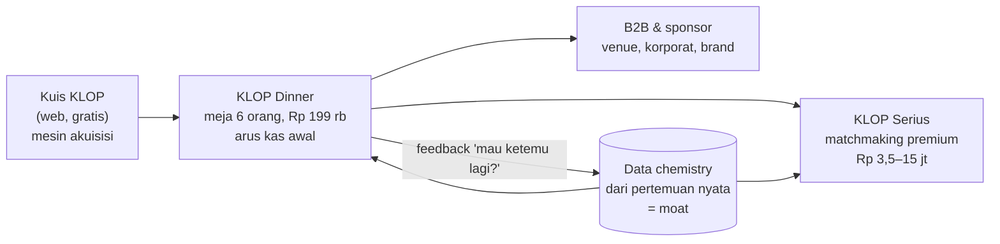
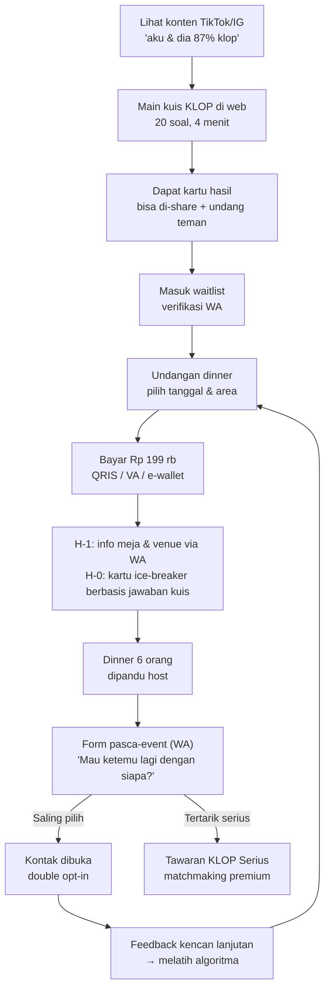
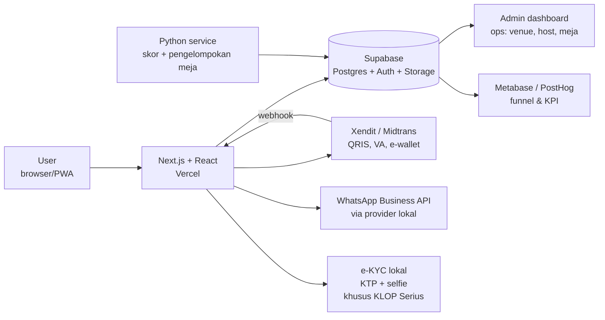
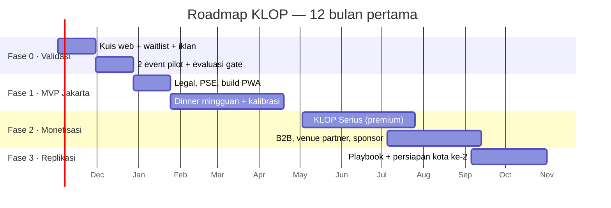

# Rencana Kerja Pivot — "KLOP": Chemistry-First Matchmaking (Offline-First)

> **Disusun untuk:** Hendri · **Tanggal:** 28 Oktober 2026 · **Kelanjutan dari:** [`REPORT.md`](REPORT.md)
> **Nama kerja:** *KLOP* (bahasa sehari-hari untuk "cocok"). Jangan pakai "Chemistry", karena sudah dipakai Tinder. Cek ketersediaan merek di PDKI sebelum dipakai.
> **Catatan:** Angka tanpa sumber diberi label **[asumsi]**. Semua angka model berasal dari [`analysis/pivot_model.py`](analysis/pivot_model.py).

---

## 1. Executive Summary

**Verdict: LAYAK dikembangkan, sebagai bisnis profitabel yang hemat modal, bukan sebagai dating app.**

Kalau saya founder sekaligus developer-nya, saya **tidak** membangun app swipe. Saya membangun **tangga monetisasi** dengan kuis chemistry di dasar tangga sebagai mesin akuisisi gratis:

| Metrik | Konsep awal (dating app) | **Pivot KLOP (base case)** |
|---|---:|---:|
| Kebutuhan modal | Rp 6,9 M | **Rp 0,63 M** |
| Break-even operasional bulanan | Tidak tercapai dalam 24 bln | **Bulan ke-9** |
| LTV / CAC | 0,23 | **5,9** |
| Revenue tahun ke-3 | – | **Rp 7,1 M** (2 kota) |
| Laba operasional tahun ke-3 | Negatif | **Rp 2,0 M** |
| Kerugian maksimum jika gagal di gate pertama | Rp 0,75 M (biaya build MVP) | **Rp 50 jt** |

**Jawaban untuk "apakah prospek monetisasinya besar?"**

| Skenario | Revenue tahun ke-3 | Laba operasional tahun ke-3 | Kategori |
|---|---:|---:|---|
| Bear (1 kota, gagal tumbuh) | Rp 1,1 M | −Rp 1,0 M | Dihentikan di gate bulan ke-6 |
| **Base** (2 kota) | **Rp 7,1 M** | **Rp 2,0 M** | **UKM digital yang sehat** |
| Bull (3 kota, premium jalan) | Rp 25,9 M | Rp 13,4 M | Besar untuk ukuran bootstrap |

- **Ya, menguntungkan.** Bisnisnya asset-light: peserta membayar makanannya sendiri ke restoran, jadi kontribusi per kursi ≈ **82%**. Payback CAC kurang dari 1 event.
- **"Besar" (Rp 25 M+/tahun) hanya kalau dua hal terbukti:** (1) matchmaking premium laku, dan (2) playbook bisa direplikasi ke kota lain. Keduanya bisa diuji murah secara bertahap.
- **Bukan unicorn.** Revenue Rp 26 M ≈ US$1,6 jt. Itu menarik untuk bootstrap/angel, belum untuk VC, kecuali ekspansi regional SEA (Timeleft membuktikan modelnya bisa jalan di ±90 kota).

---

## 2. Kenapa Pivot Ini, dan Bukan yang Lain: Re-scoring Opsi

### 2.1 Temuan riset yang mengubah arah

| Temuan | Implikasi |
|---|---|
| Statista: **matchmaking adalah segmen dating terbesar di Indonesia berdasarkan revenue (2024)**, online dating di urutan kedua | Uangnya ada di **niat serius**, bukan casual swipe |
| Biro jodoh premium Jakarta (Lunch Actually) Rp 10–129 jt per paket (2019); paket berbayar Rp 3 jt untuk 2 kencan (2024) | Willingness-to-pay segmen serius **ratusan kali lipat** ARPPU dating app (Rp 60–100 rb/bln) |
| Pernikahan Indonesia **1,48 jt (2024)**, turun 6,3% YoY dan −28,6% dalam satu dekade | Banyak orang ingin menikah tapi sulit bertemu orang yang tepat. Di sisi lain, tren ini juga risiko |
| **Timeleft** (dinner 6 orang asing yang dicocokkan lewat kuis): Series A ~US$7 jt (Jul 2024), ±90 kota/18 negara, >400 rb user, tiket €12,99–US$16, peserta bayar makan sendiri | Model "kuis → event offline" **terbukti bisa diskalakan** |
| Setipe (matchmaking berbasis tes kepribadian): >800 rb member, diakuisisi Lunch Actually (2017) | Segmen serius + kepribadian punya pasar, tapi belum ada yang **offline-first** |
| 16Personalities: laporan premium US$9/29/99; Co-Star ~US$21 jt funding | Kuis kepribadian bisa dimonetisasi, tapi nilainya kecil kalau berdiri sendiri |

### 2.2 Matriks penilaian (skala 1–5, makin tinggi makin baik)

| Opsi | Potensi revenue | Kemauan bayar | CAC rendah | Moat | Cepat jadi uang | Risiko eksekusi rendah | **Total /30** | Peran |
|---|:-:|:-:|:-:|:-:|:-:|:-:|:-:|---|
| **D. Event offline (dinner grup)** | 4 | 4 | 3 | 3 | 5 | 3 | **22** | ✅ Arus kas inti |
| **E. Niche serius / matchmaking premium** | 5 | 5 | 3 | 3 | 3 | 2 | **21** | ✅ Margin besar |
| **F. B2B (venue, korporat, brand)** | 3 | 4 | 3 | 2 | 4 | 3 | **19** | ✅ Revenue tambahan |
| G. Laporan kepribadian berbayar | 1 | 2 | 3 | 1 | 4 | 5 | 16 | ⚠️ Fitur kecil saja |
| **B. "Soal Hari Ini" ala Wordle** | 1 | 1 | 5 | 2 | 2 | 4 | 15 | ✅ Mesin akuisisi |
| **C. Bank soal tetap & akumulatif** | 2 | 2 | 2 | 2 | 1 | 3 | 12 | ✅ Fondasi engine |
| A. Chat game sinkron dalam app | 2 | 2 | 2 | 1 | 1 | 3 | 11 | ❌ Butuh app dating |

**Kesimpulan:** Tidak ada satu opsi yang cukup kalau berdiri sendiri. Kombinasinya yang kuat: **B mendatangkan orang, C memberi akurasi, D menghasilkan kas, E menghasilkan margin, F menambah revenue.**

---

## 3. Konsep Produk

### 3.1 Positioning

> **"Ketemu orang yang klop, secara langsung. Bukan swipe."**
> Dinner kecil 6 orang yang dikurasi algoritma chemistry, untuk profesional 25–35 tahun di Jakarta yang serius mencari pasangan dan lelah dengan dating app.

| Elemen | Keputusan | Alasan |
|---|---|---|
| Target awal | Profesional 25–35, Jabodetabek, belum menikah, niat serius | Kemauan bayar tertinggi, segmen matchmaking terbesar |
| Format | Dinner/brunch meja 6 orang (3 pria, 3 perempuan), 2–3 jam | Aman, tidak canggung (bukan 1-on-1), mudah diterima keluarga |
| Venue default | Restoran/kafe tanpa alkohol, area SCBD, Kemang, Senopati, PIK, BSD | Penerimaan sosial lebih luas; opsi khusus non-halal/bar untuk segmen lain |
| Varian komunitas (fase 2+) | Edisi Muslim (bukber saat Ramadan), edisi Kristen/Katolik, edisi hobi (lari, kopi, board game) | Komunitas = distribusi gratis, kepercayaan tinggi |
| Bukan | App swipe, chat in-app, lokasi real-time | Menghindari cold start, biaya moderasi, risiko keamanan |

### 3.2 Customer journey

---

## 4. Desain "Chemistry Engine" yang Benar

Desain ini memperbaiki 3 cacat konsep lama: soal random yang tidak tumpang-tindih, sampel 10 soal yang terlalu kecil, dan skor yang tidak tervalidasi.

| Komponen | Spesifikasi | Memperbaiki cacat lama |
|---|---|---|
| **Bank soal tetap** | 80 soal dalam 8 dimensi × 10: nilai hidup, keluarga & anak, peran agama, keuangan & karier, gaya komunikasi & konflik, gaya hidup, humor, ambisi | Semua user menjawab soal dari bank yang sama, jadi overlap terjamin |
| **Onboarding** | 20 soal inti wajib (sama untuk semua) | Skor bisa dihitung sejak hari pertama |
| **"Soal Hari Ini"** | 1–3 soal per hari, **sama untuk semua orang**, hasilnya bisa dibagikan | Kebiasaan harian + konten viral; profil makin akurat |
| **Bobot kepentingan** | Tiap soal: jawaban saya, jawaban yang saya terima dari pasangan, tingkat kepentingan (ala OkCupid) | Deal-breaker (mis. anak, agama) diberi bobot tinggi |
| **Skor + tingkat keyakinan** | Tampil "82% klop · dari 34 soal yang sama". Skor disembunyikan kalau overlap < 15 soal | Jujur soal ketidakpastian |
| **Optimasi meja** | 6 kursi: 3 pria + 3 perempuan, rentang usia ±5 tahun, maksimalkan rata-rata skor lintas gender, campur introvert/ekstrovert, hindari orang yang pernah semeja | Meja yang hidup, bukan sekadar skor tinggi |
| **Loop feedback (moat)** | Setelah event: "mau ketemu lagi?" per orang, rating suasana meja, dan hasil kencan lanjutan | Kalibrasi bobot soal dari **hasil pertemuan nyata**. Data ini yang tidak dimiliki pesaing |

**Algoritma pengelompokan v0 (Python):** greedy seeding (pasangan dengan skor tertinggi lebih dulu), lalu local search dengan swap antar-meja untuk memaksimalkan fungsi objektif. Fungsi objektifnya: skor chemistry, ditambah keseimbangan energi meja, dikurangi penalti usia/pernah semeja. Cukup untuk 500 orang per batch dalam hitungan detik. Upgrade ke OR-Tools (CP-SAT) hanya kalau perlu.

**Kalibrasi (mulai bulan ke-4, setelah ±1.000 kursi):** regresi logistik sederhana. Fitur: kecocokan per dimensi. Target: mutual "mau ketemu lagi". Bobot dimensi diperbarui bulanan. Hasilnya bisa dijadikan materi PR: "Data 5.000 pertemuan: dimensi yang paling memprediksi kecocokan orang Jakarta".

---

## 5. Model Bisnis & Harga

| Produk | Harga (termasuk PPN) | Isi | Margin kontribusi | Kapan dibuka |
|---|---:|---|---:|---|
| Kuis KLOP + kartu hasil | Gratis | 20 soal + Soal Hari Ini | – (biaya akuisisi) | Minggu 2 |
| Laporan Chemistry Lengkap | Rp 49 rb | Analisis 8 dimensi + tipe pasangan yang cocok | ~95% | Bulan 3 |
| **KLOP Dinner** (tiket platform) | **Rp 199 rb** | Kursi di meja 6 orang, host, ice-breaker, mutual match. Makanan dibayar sendiri di venue | **82%** (Rp 147 rb/kursi) | Minggu 6 |
| KLOP Pass (langganan) | Rp 499 rb / 3 bulan | 3 dinner + prioritas kursi | ~80% | Bulan 4 |
| **KLOP Serius** — Basic | Rp 3,5 jt / 3 bulan | Wawancara matchmaker, verifikasi KTP, 2–3 perkenalan 1-on-1 dikurasi | ~70% | Bulan 7 |
| **KLOP Serius** — Core | **Rp 7,5 jt** / 6 bulan | 4–6 perkenalan, coaching, feedback tiap kencan | ~72% (Rp 4,8 jt) | Bulan 7 |
| KLOP Serius — Prioritas | Rp 15 jt / 12 bulan | Perkenalan tanpa batas wajar, matchmaker senior | ~72% | Bulan 10 |
| Partner venue | Rp 2–5 jt/bln/venue atau welcome drink gratis | Trafik terjamin di malam sepi (Senin–Kamis) | ~100% | Bulan 6 |
| KLOP for Teams (korporat) | Rp 15–30 jt/event | Mixer lintas divisi untuk employee engagement HR | ~60% | Bulan 9 |
| Sponsor brand | Rp 10–50 jt/kampanye | Skincare, fashion, bank/fintech yang menyasar young professional | ~90% | Bulan 9 |

**Pembanding harga:** tiket Timeleft US$16 (AS), €12,99 (Belgia), 140 peso (Meksiko) ≈ Rp 125–265 rb. Harga Rp 199 rb ada di tengah rentang itu, sesuai daya beli profesional Jakarta.

**Pajak:** harga jual sudah termasuk PPN 11%. Revenue base case tahun ke-2 (Rp 5,5 M) melewati batas omzet PKP Rp 4,8 M, jadi **rencanakan pengukuhan PKP sejak bulan ke-12**.

---

## 6. Unit Economics & Model Finansial

### 6.1 Per kursi dinner (tiket Rp 199 rb)

| Komponen | Rp / kursi |
|---|---:|
| Harga tiket | 199.000 |
| PPN 11% | −19.721 |
| **Revenue bersih** | **179.279** |
| Payment gateway (3%) | −5.970 |
| Host freelance (Rp 300 rb / 18 orang) | −16.667 |
| Operasional (kartu, reservasi, buffer no-show) | −10.000 |
| **Kontribusi** | **146.643 (82%)** |

### 6.2 Akuisisi

| Funnel [asumsi] | Nilai |
|---|---:|
| Biaya iklan per kuis selesai | Rp 4.000 |
| Kuis → waitlist | 30% |
| Waitlist → beli tiket pertama | 12% |
| **CAC pembeli pertama** | **Rp 111.111** |
| Payback | **0,76 event** |
| LTV (3 event/tahun × 1,5 tahun) | Rp 659.892 |
| **LTV / CAC** | **5,9** (sehat ≥ 3) |

### 6.3 Model 36 bulan

**Asumsi kunci [asumsi]:**

| Parameter | Bear | Base | Bull |
|---|---:|---:|---:|
| Kursi/bulan matang per kota | 500 | 1.200 | 2.200 |
| Bulan menuju matang (kurva-S) | 14 | 12 | 10 |
| Harga tiket | Rp 179 rb | Rp 199 rb | Rp 229 rb |
| Klien premium baru (% kursi/bulan, mulai M7) | 0,4% | 0,8% | 1,2% |
| Harga premium rata-rata | Rp 5 jt | Rp 7,5 jt | Rp 10 jt |
| B2B per kota/bulan (mulai M9) | 0 | Rp 15 jt | Rp 40 jt |
| Kota | Jakarta | + kota ke-2 (M13) | + kota ke-2 (M13), ke-3 (M19) |

Biaya tetap di semua skenario: setup Rp 200 jt (validasi + MVP); tim Rp 45 jt/bln (M1–6), naik ke Rp 95 jt/bln (M7+); Rp 35 jt/bln per kota tambahan; Rp 15 jt per 1.000 kursi; marketing minimal Rp 40 jt/kota/bln atau lebih kalau volume menuntut, plus Rp 60 jt saat launch kota baru; overhead 10% revenue; matchmaker 25% revenue premium.

**Hasil:**

| Metrik | Bear | **Base** | Bull |
|---|---:|---:|---:|
| Kursi/bulan M12 | 447 | **1.143** | 2.167 |
| Kursi/bulan M24 | 500 | **2.343** | 5.788 |
| Revenue/bulan M12 | Rp 80 jt | **Rp 282 jt** | Rp 721 jt |
| Revenue/bulan M24 | Rp 90 jt | **Rp 577 jt** | Rp 1,94 M |
| Break-even bulanan pertama | Tidak | **M9** | M4 |
| **Kebutuhan modal (titik kas terendah)** | Rp 3,4 M* | **Rp 0,63 M** | Rp 0,39 M |
| Revenue tahun 1 / 2 / 3 | 0,5 / 1,1 / 1,1 M | **1,8 / 5,5 / 7,1 M** | 4,8 / 16,0 / 25,9 M |
| Laba operasional tahun 1 / 2 / 3 | −1,1 / −1,0 / −1,0 M | **−0,3 / 0,9 / 2,0 M** | 1,7 / 7,5 / 13,4 M |

\* *Bear tidak akan berjalan 36 bulan. Gate bulan ke-6 (Bagian 9) menghentikan proyek dengan kerugian kumulatif ≈ Rp 0,74 M. Kalau gagal di gate Fase 0, kerugiannya hanya Rp 50 jt.*

**Komposisi revenue base case bulan ke-24:** dinner 73% · premium 22% · B2B 5%. **Uji sensitivitas, base case tanpa premium sama sekali:** BEP mundur ke bulan ke-12, kebutuhan modal naik ke Rp 0,89 M, dan laba tahun ke-3 turun ~49% menjadi Rp 1,0 M. Bisnisnya tetap hidup, tapi kecil. **Premium adalah pengungkit utama dari "lumayan" ke "besar".**

---

## 7. Ukuran Pasar (Bottom-up, Jabodetabek)

| Lapisan [asumsi] | Faktor | Jumlah orang |
|---|---:|---:|
| Penduduk Jabodetabek | – | 34.000.000 |
| Usia 25–35 | 17% | 5.780.000 |
| Belum menikah (urban) | 35% | 2.023.000 |
| Profesional (≥ Rp 7 jt/bulan) | 30% | 606.900 |
| **Niat serius + mau ikut event (SAM)** | 20% | **121.380** |
| Potensi kursi/bulan (3 event/orang/tahun) | | **≈ 30.300** |

- Base case Jakarta matang (1.200 kursi/bulan) = **4% dari potensi SAM**. Konservatif.
- Bull Jakarta (2.200 kursi) = 7%.
- Kota berikutnya: Surabaya, Bandung, Medan, Makassar, Semarang. Masing-masing diasumsikan 25–40% dari ukuran Jakarta.
- Upside regional: Kuala Lumpur, Singapura, Manila, Bangkok, dengan playbook dan engine yang sama.

---

## 8. Arsitektur Teknis MVP (sesuai stack Anda)

| Modul | Fase | Effort (vibe coding + Claude Code) [asumsi] |
|---|---|---:|
| Landing + kuis 20 soal + kartu hasil yang bisa di-share | 0 | 1 minggu |
| Waitlist + verifikasi nomor WA (OTP) | 0 | 2–3 hari |
| Profil, bank soal 80, Soal Hari Ini | 1 | 1 minggu |
| Booking event + pembayaran + webhook | 1 | 1 minggu |
| Skor chemistry + pengelompokan meja (Python) | 1 | 1 minggu |
| Admin ops (venue, host, daftar meja, check-in QR) | 1 | 1 minggu |
| Form pasca-event + mutual match + buka kontak | 1 | 3–4 hari |
| Reminder & notifikasi WA otomatis | 1 | 3 hari |
| CRM matchmaking premium (pipeline, catatan, perkenalan) | 2 | 1–2 minggu |
| Kalibrasi model dari feedback | 2 | 1 minggu |

**Sengaja TIDAK dibangun di 12 bulan pertama:** app native iOS/Android, chat in-app, fitur lokasi/nearby, swipe. Semua komunikasi lewat WhatsApp, kanal yang sudah dipakai semua orang di Indonesia.

**Biaya teknologi bulanan:** Vercel + Supabase + provider WA + e-KYC ≈ Rp 3–7 jt/bulan pada skala base **[asumsi]**.

---

## 9. Roadmap 12 Bulan dengan Gate

| Fase | Waktu | Deliverable | Budget kumulatif (base) | Gate: **lanjut jika** | **Berhenti jika** |
|---|---|---|---:|---|---|
| **0. Validasi** | Minggu 1–8 | Kuis web, waitlist, 2 dinner pilot (30–40 orang) | ≤ Rp 50 jt | Waitlist ≥ 2.000 · perempuan ≥ 40% · kursi pilot terjual ≥ 70% · ≥ 50% peserta mau datang lagi | Gagal ≥ 2 KPI |
| **1. MVP Jakarta** | Bulan 3–6 | PWA lengkap, dinner mingguan, kalibrasi v1 | ≈ Rp 0,6 M | ≥ 500 kursi/bln · repeat 90 hari ≥ 35% · mutual match ≥ 25% peserta · NPS ≥ 50 · no-show ≤ 10% | < 300 kursi/bln atau repeat < 20% |
| **2. Monetisasi** | Bulan 7–12 | KLOP Serius, venue partner, KLOP for Teams | ≈ Rp 0,63 M (puncak) | ≥ 1.000 kursi/bln · ≥ 8 klien premium/bln · **operasional BEP** | Premium < 3 klien/bln selama 3 bulan → fokus dinner saja |
| **3. Replikasi** | Bulan 13–24 | Kota ke-2 (Surabaya/Bandung), playbook tertulis | dibiayai arus kas | Kota ke-2 mencapai 50% volume Jakarta dalam 6 bulan | < 25% → tahan ekspansi |
| **4. Skala** | Tahun ke-3 | Kota ke-3, keputusan: tetap bootstrap atau raise seed untuk SEA | – | Laba tahun ke-2 ≥ Rp 0,9 M | – |

**Prinsip pendanaan:** sisihkan **Rp 750 jt**, tapi cairkan **per tranche hanya kalau gate lolos**: Rp 50 jt → Rp 550 jt → sisanya sebagai cadangan. Kerugian maksimum terkunci di setiap tahap.

---

## 10. Rencana 90 Hari Pertama (per minggu)

| Minggu | Produk / Tech | Operasional / Bisnis | Output terukur |
|---|---|---|---|
| 1 | Tulis 80 soal (8 dimensi), pilih 20 soal inti; setup repo Next.js + Supabase | Cek merek "KLOP" di PDKI, domain, handle IG/TikTok; rekrut ops lead/community manager | Bank soal v1, nama aman |
| 2 | Bangun kuis web + kartu hasil yang bisa di-share + waitlist + consent UU PDP | Brief 5–10 micro-influencer Jakarta; siapkan 10 konten hasil kuis | Kuis live |
| 3 | Pasang analytics funnel (PostHog); A/B test judul kuis | Shortlist 10 venue (Senopati, Kemang, SCBD, PIK, BSD), deal 3; rekrut 3 host | 3 venue + 3 host |
| 4 | Fitur "bandingkan dengan teman" (viral loop) | Iklan TikTok/IG Rp 25 jt mulai jalan; tulis SOP keamanan & kode etik event | ≥ 5.000 kuis selesai |
| 5 | Script Python pengelompokan meja v0 (output CSV, review manual) | Undang batch pertama dari waitlist, jaga rasio gender | Daftar meja pilot |
| 6 | Form pasca-event (Tally/WA) + logika mutual match | **Dinner pilot #1** (≈ 18–24 orang, 3–4 meja) | Data feedback pertama |
| 7 | Perbaikan kuis dari data feedback | **Dinner pilot #2**; wawancara 10 peserta | NPS, mutual match rate |
| 8 | – | **GATE FASE 0**: evaluasi KPI → lanjut atau berhenti | Keputusan tertulis |
| 9 | Desain PWA: profil, booking, pembayaran | Pendirian PT, NIB via OSS (KBLI platform digital & penyelenggara event, konsultasikan dengan notaris), pendaftaran **PSE Lingkup Privat** | Legal jalan |
| 10 | Integrasi Xendit/Midtrans + webhook; tiket QR | Kontrak venue partner (welcome drink/fee); privacy policy & T&C | Pembayaran live |
| 11 | Admin ops (venue, host, meja, check-in) + reminder WA | Rekrut 3 host tambahan; kalender event mingguan | 2 event/minggu siap |
| 12 | Engine pengelompokan masuk ke backend; dashboard KPI | Launch publik "KLOP Dinner" setiap Kamis & Sabtu | ≥ 120 kursi/minggu |
| 13 | Retro & backlog Fase 1 | Review biaya per kursi, CAC aktual vs model | Model diperbarui dengan data nyata |

---

## 11. Tim & Struktur Biaya

| Peran | Status | Biaya/bulan [asumsi] | Mulai | Tanggung jawab |
|---|---|---:|---|---|
| **Hendri** — founder/CEO | Part-time 10–15 jam/minggu | – (equity) | M0 | Strategi, keuangan, produk, vibe coding MVP, kemitraan |
| Ops lead / community manager | Full-time | Rp 10–12 jt | M0 | Event, venue, host, waitlist. **Peran paling kritis**; idealnya perempuan dengan jaringan profesional Jakarta |
| Developer freelance | Kontrak 3 bulan | Rp 10–15 jt | M2 | Pembayaran, admin, hardening keamanan |
| Content creator | Part-time | Rp 5–6 jt | M1 | TikTok/IG dari hasil kuis & cerita event |
| Host event | Freelance | Rp 300 rb/malam | M1 | Memandu meja, keamanan, laporan |
| Matchmaker / konsultan | Full-time | Rp 8–10 jt + komisi | M7 | KLOP Serius |
| CS / admin | Full-time | Rp 6 jt | M7 | WA, refund, jadwal |
| City manager (per kota baru) | Full-time | Rp 12–15 jt | M13 | Replikasi playbook |

**Catatan jujur soal waktu Anda:** bisnis ini **operasional dan berbasis komunitas**. Dengan Apotek Alpro dan trading berjalan, Anda tidak bisa jadi operator harian. Keberhasilan sangat bergantung pada **ops lead yang tepat**. Pertimbangkan memberinya equity 5–10% dengan vesting.

---

## 12. Go-to-Market

| Kanal | Taktik | Kenapa efektif |
|---|---|---|
| TikTok / IG Reels | Konten "aku vs pacar: 64% klop, ini soal yang bikin beda", reaksi peserta setelah dinner, statistik dari data | Kuis + hasil = konten yang menyebar sendiri |
| Viral loop | "Bandingkan dengan teman/gebetan" → teman harus main kuis dulu | Setiap user mendatangkan user lain |
| Women-first | Rilis kursi dijaga 50:50; perempuan bisa ajak 1 teman perempuan; venue & jam yang aman | Rasio gender adalah KPI hidup-mati |
| Komunitas | Alumni kampus, komunitas lari/kopi/buku, grup kantor | Kepercayaan tinggi, CAC hampir nol |
| Partner venue | Poster/QR di venue, promosi silang di IG venue | Venue butuh trafik di malam sepi |
| Momen | Edisi Valentine, bukber Ramadan, "Tahun Baru, Teman Baru", libur panjang | Puncak permintaan musiman |
| PR | Rilis data: "Apa yang bikin orang Jakarta klop? Data 5.000 pertemuan" | Media suka data lokal; membangun brand |
| Referral | Ajak teman → kursi berikutnya diskon Rp 50 rb | Menurunkan CAC blended |

---

## 13. Legal, Keamanan & Kepatuhan

| Area | Tindakan | Kapan |
|---|---|---|
| Badan usaha | PT (atau PT perorangan di awal), NIB via OSS; konsultasikan KBLI dengan notaris | Minggu 9 |
| **PSE Lingkup Privat** | Daftar sebelum menerima pembayaran publik (contoh sanksi: Zangi diblokir Okt 2025) | Minggu 9–10 |
| **UU PDP No. 27/2022** | Consent eksplisit untuk jawaban kuis (nilai, agama, keluarga); data e-KYC/biometrik khusus KLOP Serius dengan DPIA; tunjuk penanggung jawab data; retensi & hapus akun | Sejak kuis live |
| Pajak | PPN termasuk di harga; pengukuhan PKP sebelum omzet > Rp 4,8 M; e-Faktur untuk B2B | M12 |
| Perlindungan konsumen | T&C jelas: KLOP Serius **menjamin jumlah perkenalan, bukan jodoh** (cegah sengketa seperti kasus biro jodoh 2024); kebijakan refund | Sebelum premium dibuka |
| **Keamanan peserta** | Verifikasi nomor WA; KTP untuk premium; kode etik; host di setiap event; kontak dibuka hanya lewat double opt-in; tombol lapor; blacklist bersama | Sejak event pilot |
| SOP insiden | Eskalasi pelecehan, ban permanen, dukungan korban, koordinasi venue | Sebelum event pilot |
| Norma sosial | Venue tanpa alkohol sebagai default, positioning "serius & sopan", edisi komunitas agama | Sejak awal |

---

## 14. Risiko & KPI

### 14.1 Risiko utama

| Risiko | Prob. | Dampak | Mitigasi |
|---|:-:|:-:|---|
| Rasio gender timpang (pria > perempuan) | Tinggi | 🔴 | Rilis kursi 50:50, women-first marketing, waitlist pria lebih panjang |
| Ops lead tidak tepat / founder kurang waktu | Sedang | 🔴 | Rekrut cermat, equity + vesting, SOP tertulis sejak awal |
| Ditiru EO lokal (hambatan masuk rendah) | Tinggi | 🟠 | Moat: data feedback, komunitas, brand trust, kecepatan replikasi |
| Insiden keamanan di event | Rendah–sedang | 🔴 | Host, verifikasi, SOP, asuransi event, venue publik |
| Premium tidak laku | Sedang | 🟠 | Base tetap BEP dari dinner; uji harga Rp 3,5 jt dulu |
| Musiman (Ramadan, akhir tahun) | Tinggi | 🟡 | Format pengganti (bukber, brunch), kas cadangan 3 bulan |
| Timeleft masuk Indonesia | Sedang | 🟠 | Diferensiasi: niat serius + matchmaking premium + edisi komunitas lokal (Timeleft = pertemanan umum) |
| Tren pernikahan menurun | Pasti | 🟡 | Positioning juga untuk "ketemu orang baru yang klop", bukan hanya menikah |

### 14.2 Dashboard KPI

| KPI | Definisi | Target M6 | Target M12 |
|---|---|---:|---:|
| **North star: mutual match / bulan** | Pasangan yang saling pilih "mau ketemu lagi" | 150 | 400 |
| Kursi terjual / bulan | – | 500 | 1.000+ |
| Fill rate | Kursi terjual / kursi tersedia | ≥ 85% | ≥ 90% |
| Rasio perempuan | Dari total kursi | ≥ 45% | ≥ 48% |
| Repeat 90 hari | Peserta yang datang lagi | ≥ 35% | ≥ 40% |
| No-show | – | ≤ 10% | ≤ 7% |
| NPS pasca-event | – | ≥ 50 | ≥ 60 |
| CAC pembeli pertama | – | ≤ Rp 120 rb | ≤ Rp 100 rb |
| Klien premium baru / bulan | – | – | ≥ 8 |

---

## 15. Verdict Akhir

| Pertanyaan | Jawaban |
|---|---|
| Apakah pivot ini layak dikembangkan? | **✅ Ya.** Kebutuhan modal ~Rp 0,6 M (base), BEP bulan ke-9, LTV/CAC 5,9 |
| Apakah monetisasinya besar? | **Sedang-ke-besar.** Base Rp 7 M revenue di tahun ke-3; bull Rp 26 M. Penentunya premium matchmaking + replikasi kota |
| Apakah ini venture-scale? | **Belum.** Bisa jadi venture-scale hanya dengan ekspansi regional SEA |
| Apa moat-nya? | Data chemistry dari **pertemuan nyata** + komunitas + brand trust. Bukan fitur kuis |
| Risiko terbesar | Rasio gender, kualitas ops lead, waktu founder |
| **Langkah besok pagi** | Minggu 1 di Bagian 10: tulis 80 soal, cek merek, mulai cari ops lead. Budget Fase 0 maksimal **Rp 50 jt** |

---

## 16. Sumber

**Model & pembanding**
- [Brussels Times — Table for six (strangers): Timeleft](https://www.brusselstimes.com/belgium/1160308/table-for-six-strangers-fighting-urban-loneliness-over-dinner/)
- [Connexion France — Timeleft: 44.000+ dinner, 236.000+ peserta](https://www.connexionfrance.com/news/how-to-meet-new-people-over-dinner-in-france-we-try-out-new-app/682998)
- [CDMX Secreta — Timeleft Mexico City (90 kota, 400 rb user, harga)](https://cdmxsecreta.com/en/timeleft-cdmx-2/)
- [NewsTribune — Is dining with strangers the cure for loneliness? (harga AS)](https://www.newstribune.com/news/2024/nov/03/is-dining-with-strangers-the-cure-for-loneliness/)
- [CB Insights — Timeleft funding](https://www.cbinsights.com/company/timeleft/financials)
- [16Personalities — Premium reports for professionals](https://www.16personalities.com/professionals)
- [Axios — Co-Star raises $15 million](https://www.axios.com/2021/04/14/astrology-app-co-star-raises-15-million-funding)

**Pasar Indonesia**
- [Statista — Indonesia dating services revenue by segment](https://www.statista.com/forecasts/1365568/indonesia-dating-services-revenue-by-segment)
- [Katadata — Angka pernikahan di Indonesia turun](https://katadata.co.id/amp/berita/nasional/671ca4703017e/angka-pernikahan-di-indonesia-turun-wanita-mandiri-banyak-pria-mapan-sedikit)
- [GoodStats — Tren pernikahan menurun 6 tahun terakhir](https://goodstats.id/article/tren-pernikahan-menurun-selama-6-tahun-terakhir-gen-z-memilih-marriage-free-Ynn8x)
- [Global Dating Insights — Lunch Actually akuisisi Setipe](https://www.globaldatinginsights.com/news/lunch-actually-builds-portfolio-acquiring-indonesian-dating-service-setipe/)
- [Databoks — Aplikasi dating terpopuler Indonesia awal 2024](https://databoks.katadata.co.id/en/technology-telecommunications/statistics/9e26634a2892b0b/this-is-indonesias-most-popular-online-dating-app-in-early-2024)
- [detikFinance — Biro jodoh eksekutif, biaya hingga ratusan juta](https://finance.detik.com/read/2019/02/14/124919/4427786/4/biro-jodohnya-para-eksekutif-biaya-daftarnya-hingga-ratusan-juta)
- [Bisnis.com — Biro jodoh premium, member fee Rp 6 juta](https://kabar24.bisnis.com/read/20141002/79/261883/biro-jodoh-premium-konsep-kencan-makan-siang-member-fee-rp6-juta)
- [detikNews — Sudah bayar biro jodoh tapi tak dapat jodoh, bisakah digugat?](https://news.detik.com/berita/d-7543781/sudah-bayar-biro-jodoh-tapi-tak-dapat-jodoh-bisakah-saya-gugat)

**Regulasi** — lihat Bagian 13 di [`REPORT.md`](REPORT.md).
