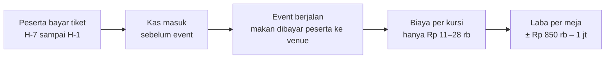
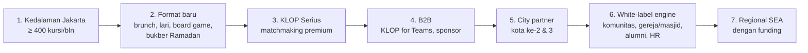

# Blueprint KLOP v2 — Lean-First: Kuis Chemistry → Dinner Grup → Matchmaking

> **Disusun untuk:** Hendri · **Tanggal:** 28 Oktober 2026 · **Versi:** 2 (lean-first). Versi 1 (tim bergaji) ada di riwayat git.
> **Kelanjutan dari:** [`REPORT.md`](REPORT.md) · **Model:** [`analysis/lean_model.py`](analysis/lean_model.py)
> **Nama kerja:** *KLOP* ("cocok"). Jangan pakai "Chemistry", karena sudah dipakai Tinder.
> Angka tanpa sumber diberi label **[asumsi]**.

---

## 1. Ringkasan & Verdict

**Verdict: LAYAK dan bisa dimulai dengan kas keluar maksimum Rp 15–35 jt.** Kuncinya: tiket dibayar di muka, makanan dibayar peserta sendiri ke venue, dan co-founder tidak mengambil gaji sampai bisnisnya menghasilkan laba.

| | v1 (tim bergaji) | **v2 (lean-first)** |
|---|---:|---:|
| Kas keluar maksimum | Rp 630 jt (base) | **Rp 15 jt (base)** · Rp 34 jt (bear) |
| Biaya tetap/bulan | Rp 90–140 jt | **Rp 5–8 jt** |
| Titik impas operasional | ±700–1.000 kursi/bulan | **33–48 kursi/bulan** (≈ 2–3 meja/minggu) |
| Laba bulanan pertama (base) | Bulan 9 | **Bulan 1–3** |
| Tim | 5–7 karyawan | **3 co-founder + 2 founding host + 1 AI agent** |
| Revenue tahun ke-2 (base) | Rp 5,5 M (2 kota) | **Rp 1,25 M** (1 kota) |
| Laba tahun ke-2 (base) | Rp 0,9 M setelah gaji | **Rp 0,84 M** sebelum kompensasi founder |
| Kerugian maksimum kalau gagal | Rp 50 jt (gate 1) → Rp 0,74 M (gate 2) | **Rp 15 jt** (gate 1) → **±Rp 34 jt** (gate 2) |

**Trade-off yang harus diterima:** v2 jauh lebih aman, tapi tumbuh sekitar **4× lebih lambat**. Penyebabnya, marketing bergantung pada organik dan founder bekerja part-time. Jalur cepat v1 tetap bisa diambil nanti, dibiayai dari laba atau angel investor **setelah** traksi terbukti. Dengan begitu risikonya ditanggung data, bukan tabungan.

**Jawaban atas tiga pertanyaan:**

| Pertanyaan | Jawaban singkat |
|---|---|
| Bisa mulai dengan modal jauh lebih kecil? | **✅ Ya.** Fase 0 cukup Rp 15 jt. Sesudahnya bisnis membiayai dirinya sendiri, kecuali skenario bear yang butuh tambahan ±Rp 19 jt sebelum dihentikan atau balik untung |
| Cukup 1 AI agent + sedikit orang? | **✅ Untuk teknologi & back-office. ❌ Untuk inti bisnis.** AI agent bisa mengerjakan ±80% pekerjaan teknis. Hosting, komunitas, venue, dan keamanan tetap pekerjaan manusia |
| 5 co-founder? | **⚠️ Terlalu banyak.** Rekomendasi: **3 co-founder inti + 2 founding host** dengan bagi hasil. Alasannya di Bagian 5 |

---

## 2. Kenapa Modal Bisa Turun Drastis

| Sumber biaya di v1 | Porsi | Di v2 |
|---|---:|---|
| Gaji tim (ops lead, dev, konten, matchmaker, CS) | ±60% | **Diganti sweat equity** 3 co-founder; dev dikerjakan AI agent |
| Marketing berbayar Rp 40 jt/bulan | ±25% | **Rp 3 jt/bulan minimum**, naik ke 15% revenue setelah ada omzet |
| Setup MVP Rp 150 jt | ±10% | **AI agent + tools gratis** (≈ Rp 1,65 jt/bulan) |
| PPN 11% di harga | – | **Belum PKP** (omzet < Rp 4,8 M): cukup PPh final UMKM 0,5% |

**Modal kerja negatif:** uang peserta masuk sebelum event, dan biaya utama (makanan) bukan tanggungan KLOP. Setiap meja menghasilkan laba sejak event pertama. Model ini memang paling cocok untuk di-bootstrap.

---

## 3. Stack Teknologi Rp 0 + 1 AI Agent

| Fungsi | Tools awal | Biaya | Upgrade saat | Catatan |
|---|---|---:|---|---|
| AI agent (developer, analis, penulis) | Claude Code via **Claude Max 5x** | US$100 ≈ Rp 1,65 jt/bln | – | Pro US$20 cukup di minggu 1–2; Max untuk build intensif |
| Kuis + landing | Next.js, dibangun AI agent | Rp 0 | – | – |
| Hosting | **Cloudflare Pages** (gratis, boleh komersial) | Rp 0 | – | **Jangan Vercel Hobby**: hanya untuk non-komersial |
| Database & auth | Supabase free | Rp 0 | Bulan 6 → Pro US$25 | Free tier tanpa backup dan bisa auto-pause; jangan simpan data nyata lama-lama di sini |
| Pembayaran | Xendit payment link / QRIS | QRIS ±0,63–0,7%, VA Rp 4.000 | – | Tanpa biaya bulanan |
| Komunikasi | **WhatsApp Business app** + Community | Rp 0 | > ±500 peserta aktif/bulan → WA Business API (±Rp 240–600/pesan) | Broadcast massal di app biasa berisiko nomor diblokir |
| Pengelompokan meja | Script Python (dijalankan lokal/Colab) | Rp 0 | Bulan 4 → masuk backend | – |
| Desain & konten | Canva free, CapCut | Rp 0 | – | Kartu ice-breaker per meja di-generate AI |
| Form pasca-event | Tally / Google Form | Rp 0 | Bulan 3 → fitur di web | – |
| Analitik | PostHog free / Google Sheets | Rp 0 | – | – |

**Total biaya teknologi: ±Rp 2–3 jt/bulan**, sebagian besar untuk AI agent.

---

## 4. Pembagian Kerja: AI Agent vs Manusia

| Tugas | Pelaksana | Catatan |
|---|---|---|
| Membangun kuis, landing, waitlist, booking, admin | 🤖 **AI penuh**, direview Hendri | Hendri sudah biasa vibe coding dengan Claude Code |
| Script skor chemistry + pengelompokan meja | 🤖 AI penuh | Output tetap dicek manusia sebelum dikirim |
| Kartu ice-breaker personal per meja | 🤖 AI penuh | Dari jawaban kuis peserta di meja itu |
| Draft caption, skrip video, copy iklan | 🤖 AI + review | Video wajah manusia tetap jauh lebih efektif |
| Analisis funnel, feedback, kalibrasi bobot soal | 🤖 AI + review | Laporan mingguan otomatis |
| SOP, T&C, privacy policy draft, template kontrak | 🤖 AI draft | **Final wajib dicek notaris/konsultan hukum** |
| Draft balasan CS di WhatsApp | 🤖 AI draft | **Manusia yang mengirim.** Jangan auto-reply ke peserta soal hal sensitif |
| Review keamanan kode & akses data pribadi | 👤 Hendri (+ AI sebagai alat cek) | Tanggung jawab UU PDP tidak bisa didelegasikan ke AI |
| Hosting dinner | 👤 Manusia saja | – |
| Rekrut & menjaga komunitas (terutama perempuan) | 👤 Manusia saja | Faktor hidup-mati bisnis ini |
| Negosiasi & relasi venue | 👤 Manusia saja | – |
| Penanganan insiden & keputusan ban | 👤 Manusia saja | – |
| Wawancara matchmaking premium | 👤 Manusia (AI menyiapkan ringkasan profil) | – |

**Kesimpulan objektif:** satu AI agent realistis menggantikan **developer, analis data, dan copywriter junior**. Ia **tidak** menggantikan community manager dan host, padahal dua peran itu yang menentukan apakah orang datang lagi.

**Guardrail:**
1. Tidak ada pesan otomatis dari AI langsung ke peserta tanpa persetujuan manusia.
2. Data mentah peserta (nomor WA, jawaban soal agama/keluarga) tidak ditempel ke prompt. Gunakan ID anonim saat menganalisis.
3. Setiap perubahan kode yang menyentuh pembayaran atau data pribadi direview manual sebelum deploy.

---

## 5. Struktur Tim: Kenapa Bukan 5 Co-founder

### 5.1 Kritik terhadap 5 co-founder setara

| Masalah | Dampak |
|---|---|
| **Laba dibagi tipis** | Base tahun ke-1: laba sebelum kompensasi rata-rata Rp 34,7 jt/bulan. Dibagi 5 = **Rp 6,9 jt/orang/bulan**; dibagi 3 = Rp 11,5 jt. Di bulan-bulan awal jauh lebih kecil |
| **Dead equity** | Founder yang berhenti di bulan ke-4 tetap memegang 20% selamanya kalau tidak ada vesting |
| **Komitmen tidak merata** | Lima orang part-time jarang punya jam kerja yang sama. Muncul rasa tidak adil, lalu konflik |
| **Keputusan lambat** | 5 suara untuk keputusan harian event = lambat |
| **Dilusi untuk investor/partner nanti** | Cap table penuh sejak hari pertama |

### 5.2 Rekomendasi: 3 + 2 + 1

| Peran | Siapa | Komitmen | Kompensasi | Tanggung jawab |
|---|---|---|---|---|
| **Co-founder 1 — Produk, Tech & Keuangan** | Hendri | 8–12 jam/minggu | Equity | Mengarahkan AI agent, review kode & data, keuangan, legal, kemitraan |
| **Co-founder 2 — Komunitas & Operasional** | Idealnya perempuan dengan jaringan profesional Jakarta | 20–25 jam/minggu → full-time saat laba ≥ Rp 30 jt/bln | Equity + stipend pertama | Waitlist, rasio gender, venue, jadwal, host, keamanan. **Peran paling kritis** |
| **Co-founder 3 — Growth & Konten** | Kreator konten / marketer | 10–15 jam/minggu | Equity | TikTok/IG, influencer, referral, PR data |
| **Founding Host ×2** | Orang yang hangat & bisa memandu meja | 1–2 malam/minggu | **Rp 300 rb/malam** (bagi hasil) + opsi saham kecil (ESOP 1–2%, vesting) | Memandu dinner, laporan pasca-event, kandidat matchmaker |
| **AI agent** | Claude Code | – | Rp 1,65 jt/bln | Lihat Bagian 4 |

**Kapasitas hosting:** 3 co-founder masing-masing hosting 1 malam/minggu ≈ **232 kursi/bulan tanpa biaya host**. Di atas itu, founding host dan host freelance (Rp 300 rb/malam per 18 orang).

**Kebijakan kompensasi founder [usulan]:** mulai bayar stipend saat **rata-rata laba 3 bulan ≥ Rp 30 jt**. Alokasinya: 55% stipend founder, 30% cadangan kas, 15% iklan. Di base case ini tercapai sekitar bulan ke-7.

---

## 6. Struktur Legal & Equity

| Tahap | Bentuk | Biaya | Catatan |
|---|---|---:|---|
| Fase 0 (minggu 1–8) | **Belum ada badan usaha.** Perjanjian para pendiri tertulis, ditandatangani | Rp 0 | Rekening & akun pembayaran khusus KLOP atas nama satu founder, dengan pencatatan terbuka untuk semua founder |
| Gate 0 lolos (±bulan 3) | **PT biasa** (akta notaris), lalu NIB via OSS dan **daftar PSE Lingkup Privat** | ±Rp 5–8 jt [asumsi] | **PT Perorangan tidak bisa dipakai**: hanya untuk 1 pendiri |
| Pajak | PPh final UMKM 0,5% omzet; pengukuhan PKP sebelum omzet > Rp 4,8 M/tahun | – | Base case belum mencapai batas PKP sampai tahun ke-2 |

**Isi wajib perjanjian para pendiri:**

| Klausul | Isi |
|---|---|
| Vesting | 4 tahun, cliff 1 tahun. Setelah PT berdiri, terapkan reverse vesting (opsi beli kembali saham yang belum vested) |
| IP assignment | Semua kode (termasuk yang dibuat AI agent), bank soal, data, merek, dan konten **milik PT**, bukan milik pribadi |
| Komitmen | Jam minimum per minggu dan KPI per peran; evaluasi tiap 3 bulan |
| Kerahasiaan & non-solicit | Data peserta dan bobot algoritma rahasia. Dilarang membawa daftar peserta ke usaha sejenis selama 12 bulan setelah keluar |
| Keputusan | Siapa memutuskan apa; tie-breaker |
| Keluar | Good leaver / bad leaver, harga beli kembali saham |

**Contoh pembagian equity [ilustrasi, sesuaikan dengan kontribusi]:** Co-founder 1 (Hendri, plus modal Fase 0) 40% · Co-founder 2 (Komunitas) 30% · Co-founder 3 (Growth) 20% · pool ESOP untuk founding host dan karyawan awal 10%.

---

## 7. Anggaran Bertahap

### 7.1 Fase 0: Rp 15 jt (minggu 1–8)

| Item | Rp |
|---|---:|
| Merek DJKI kelas 45 (layanan perkenalan/sosial), tarif UMKM | 500.000 |
| Domain + email bisnis | 300.000 |
| AI agent: Claude Max 5x, 2 bulan | 3.300.000 |
| Iklan TikTok/IG untuk uji kuis | 6.000.000 |
| Materi 2 dinner pilot (kartu, name tag, reservasi) | 2.000.000 |
| Produksi konten (transport, properti) | 1.000.000 |
| Cadangan refund & tak terduga | 1.900.000 |
| **Total** | **15.000.000** |
| Tiket 2 dinner pilot masuk kembali (2 × 24 kursi × Rp 149 rb) | **+7.152.000** |

**Kas bersih Fase 0 ≈ Rp 8 jt** kalau kursi pilot terjual penuh.

### 7.2 Sesudah Fase 0: dibiayai tiket

| Bulan | Biaya tetap/bulan | Isi |
|---|---:|---|
| 1–3 | Rp 5,15 jt | AI agent, tools, iklan minimum Rp 3 jt |
| 3 (sekali) | Rp 8,5 jt | Akta PT + merek 3 kelas tambahan (9 aplikasi, 41 event, 42 software) |
| 4–6 | Rp 6,15 jt | + konsultan pajak/akuntan |
| 7+ | Rp 7,56 jt | + Supabase Pro + WA Business API |

### 7.3 Unit economics per kursi (belum PKP, tanpa PPN)

| Harga tiket | Payment | PPh final | Ops | Kontribusi (host co-founder) | Kontribusi (host berbayar) |
|---:|---:|---:|---:|---:|---:|
| Rp 149 rb | Rp 2.235 | Rp 745 | Rp 8.000 | Rp 138.020 (93%) | Rp 121.353 (81%) |
| **Rp 169 rb** | Rp 2.535 | Rp 845 | Rp 8.000 | **Rp 157.620 (93%)** | Rp 140.953 (83%) |
| Rp 179 rb | Rp 2.685 | Rp 895 | Rp 8.000 | Rp 167.420 (94%) | Rp 150.753 (84%) |

Harga Rp 169 rb tanpa PPN memberi margin yang sama dengan Rp 199 rb termasuk PPN di v1, dan lebih ramah untuk pembeli pertama.

---

## 8. Model Lean 24 Bulan

**Asumsi [asumsi]:**

| Parameter | Bear | Base | Bull |
|---|---:|---:|---:|
| Kursi/bulan matang (Jakarta) | 150 | 500 | 900 |
| Bulan menuju matang | 14 | 12 | 10 |
| Harga tiket | Rp 149 rb | Rp 169 rb | Rp 179 rb |
| Klien premium baru (% kursi/bulan, mulai M7) | 0,4% | 0,6% | 1,0% |
| Harga premium (dijalankan founder) | Rp 3,5 jt | Rp 5 jt | Rp 7,5 jt |
| B2B/bulan (mulai M9) | 0 | Rp 5 jt | Rp 15 jt |
| City partner (kota ke-2, bagi hasil 30%) | – | – | mulai M13 |

**Hasil:**

| Metrik | Bear | **Base** | Bull |
|---|---:|---:|---:|
| Kas keluar maksimum | Rp 33,8 jt | **Rp 15,0 jt** | Rp 15,0 jt |
| Laba bulanan pertama | M5 | **M1** | M1 |
| Kursi/bulan M6 / M12 | 59 / 134 | **250 / 476** | 581 / 887 |
| Revenue tahun 1 / 2 | Rp 134 jt / 288 jt | **Rp 639 jt / 1,25 M** | Rp 1,62 M / 3,06 M |
| Laba sebelum kompensasi founder, tahun 1 / 2 | Rp 34 jt / 165 jt | **Rp 416 jt / 844 jt** | Rp 1,10 M / 2,11 M |
| **Per founder per bulan, tahun 1 — 3 orang** | Rp 0,9 jt | **Rp 11,5 jt** | Rp 30,5 jt |
| **Per founder per bulan, tahun 1 — 5 orang** | Rp 0,6 jt | **Rp 6,9 jt** | Rp 18,3 jt |
| Komposisi revenue M24 | dinner 91% · premium 9% | **dinner 81% · premium 14% · B2B 5%** | dinner 61% · premium 26% · B2B 6% · partner 7% |

**Cara membaca:**
- **Base:** bisnis kecil yang sehat sejak awal. Untuk 3 founder, pendapatannya setara gaji profesional mulai bulan ke-6–9. Untuk 5 founder, setara gaji entry-level. Inilah inti kritik terhadap 5 co-founder.
- **Bear:** tidak rugi besar, tapi juga tidak layak dijalankan (Rp 4,6 jt/founder/bulan di tahun ke-2). Gate bulan ke-6 akan menghentikannya.
- **Bull:** baru di sini city partner, premium, dan B2B bersama-sama membawa bisnis ke skala yang membenarkan full-time dan funding.
- **Kelemahan model:** asumsi kursi lean (500/bulan di base) bergantung pada pertumbuhan organik. **Variabel paling tidak pasti adalah kecepatan pertumbuhan, bukan modal.** Gate di Bagian 9 ada untuk mengujinya.

---

## 9. Roadmap Lean dengan Gate

| Fase | Waktu | Kas | Gate: **lanjut jika** | **Berhenti jika** |
|---|---|---:|---|---|
| **0. Validasi** | Minggu 1–8 | Rp 15 jt | Waitlist ≥ 1.000 · perempuan ≥ 40% · kursi pilot terjual ≥ 70% · ≥ 50% peserta mau datang lagi | Gagal ≥ 2 KPI → rugi maks. Rp 15 jt |
| **1. Ritme Jakarta** | Bulan 1–6 | dari tiket | ≥ 200 kursi/bln · repeat 90 hari ≥ 30% · perempuan ≥ 45% · NPS ≥ 50 · nol insiden serius | < 100 kursi/bln di M6 → rugi maks. ±Rp 34 jt |
| **2. Monetisasi** | Bulan 7–12 | dari laba | ≥ 400 kursi/bln · ≥ 3 klien premium/bln · co-founder 2 full-time dengan stipend | Premium < 1/bln selama 3 bulan → fokus dinner |
| **3. Replikasi** | Bulan 13–24 | dari laba | Lihat tangga ekspansi di Bagian 11 | – |

### 9.1 Rencana 12 minggu pertama

| Minggu | 🤖 AI agent (diarahkan Hendri) | 👤 Hendri | 👤 Komunitas | 👤 Growth | 👤 Host |
|---|---|---|---|---|---|
| 1 | Draft 80 soal (8 dimensi) → Hendri kurasi 20 inti | Daftar merek kelas 45, domain, perjanjian para pendiri | Daftar 30 calon peserta perempuan dari jaringan sendiri | Handle IG/TikTok, 5 konten pertama | – |
| 2 | Bangun kuis + kartu hasil + waitlist, deploy di Cloudflare Pages | Review keamanan & consent UU PDP | Shortlist 10 venue | Brief 5 micro-influencer | – |
| 3 | Fitur "bandingkan dengan teman" | Setup Xendit payment link | Deal 3 venue (malam Senin–Kamis) | Iklan Rp 6 jt mulai jalan | Latihan SOP host |
| 4 | Dashboard funnel otomatis | Tulis SOP keamanan & kode etik (draft AI) | Undang batch pertama, rasio 50:50 | Konten hasil kuis | – |
| 5 | Script pengelompokan meja v0 + kartu ice-breaker per meja | Cek ulang output meja | Konfirmasi peserta via WA | – | Simulasi dinner internal |
| 6 | Form pasca-event + logika mutual match | – | **Dinner pilot #1** | Dokumentasi | **Hosting** |
| 7 | Analisis feedback + perbaikan kuis | – | **Dinner pilot #2** | Video testimoni | **Hosting** |
| 8 | Laporan gate otomatis | **GATE 0: keputusan bersama** | ← | ← | ← |
| 9 | Halaman booking + pembayaran QRIS | Akta PT via notaris | Kalender dinner mingguan | Program referral | – |
| 10 | Admin ops sederhana (daftar meja, check-in QR) | NIB via OSS, daftar PSE | Kontrak venue preferensi | Kolaborasi komunitas lari/kopi | 1 malam/minggu |
| 11 | Reminder WA (template manual dulu) | Merek kelas 9, 41, 42 | Rekrut 2 host cadangan | PR mini: "data 100 pertemuan pertama" | 1 malam/minggu |
| 12 | Retro + backlog bulan ke-4 | Review keuangan vs model | Target 3 malam/minggu | – | 1–2 malam/minggu |

---

## 10. Melindungi Moat

**Kejujuran dulu:** di bulan-bulan awal KLOP **belum punya moat**. Konsep dinner 6 orang bisa ditiru EO mana pun dalam sebulan. Moat harus **dibangun dan ditumpuk** dengan sengaja.

### 10.1 Yang TIDAK bisa diandalkan

| Hal | Kenapa tidak |
|---|---|
| Paten algoritma | Program komputer dan metode bisnis praktis tidak bisa dipatenkan |
| Hak cipta kode buatan AI | Perlindungannya lemah dan belum pasti; kodenya juga mudah ditulis ulang |
| Konsep "dinner dengan orang asing" | Ide tidak bisa dilindungi. Timeleft sudah ada di ±90 kota |

### 10.2 Lapisan proteksi yang nyata

| Lapisan | Tindakan | Kapan | Biaya |
|---|---|---|---:|
| **1. Merek** | DJKI kelas 45 (minggu 1), lalu 9, 41, 42; domain variasi (.id, .com); semua handle sosmed | Minggu 1 & 11 | Rp 500 rb/kelas (UMKM) |
| **2. Rahasia dagang** | Bobot soal, aturan pengelompokan, dan dataset feedback hanya di server; skor saja yang tampil ke user; akses data berbasis peran; NDA untuk founder, host, dan kontraktor | Sejak kode pertama | Rp 0 |
| **3. Data dari pertemuan nyata** | Setiap dinner menghasilkan data "siapa mau ketemu siapa lagi". Setelah ±5.000 pertemuan, KLOP tahu apa yang membuat orang Jakarta cocok. Pesaing baru mulai dari nol | Tumbuh tiap minggu | Rp 0 |
| **4. Komunitas & alumni** | "KLOP Circle": grup alumni, event khusus alumni, ambassador per kantor/kampus. Orang datang karena komunitasnya, bukan sekadar format | Bulan 3+ | Rp 0 |
| **5. Pasokan venue** | Kontrak venue preferensi untuk slot malam sepi; data rating venue dari peserta | Bulan 3+ | Rp 0 |
| **6. Reputasi keamanan** | Rekam jejak nol insiden, verifikasi, host terlatih, reputasi "tempat aman untuk perempuan". Ini yang paling sulit ditiru cepat | Sejak pilot | Rp 0 |
| **7. Kecepatan & ritme** | Dinner setiap minggu tanpa absen, playbook tertulis, tim yang belajar dari data lebih cepat dari peniru | Selamanya | – |

### 10.3 Ancaman & mitigasi

| Ancaman | Mitigasi |
|---|---|
| EO lokal meniru format | Diferensiasi: data chemistry + matchmaking premium + komunitas alumni; kecepatan |
| Timeleft masuk Indonesia | Positioning berbeda: Timeleft = pertemanan umum; KLOP = niat serius + edisi komunitas lokal (bukber, gereja, alumni) + premium |
| Co-founder/host keluar membawa daftar peserta | Vesting, IP assignment, non-solicit 12 bulan, akses data terbatas per peran, log akses |
| Kebocoran data | Enkripsi, minim data, backup terpisah (Supabase Pro), review akses tiap bulan |
| Tiruan memakai nama mirip | Merek terdaftar lebih dulu; somasi berbasis merek |

---

## 11. Strategi Ekspansi (asset-light)

| Tahap | Trigger untuk mulai | Model | Kebutuhan modal |
|---|---|---|---:|
| 1. Kedalaman Jakarta | Gate 1 lolos | Dinner 3+ malam/minggu, 3–5 area | Dari tiket |
| 2. Format baru | ≥ 300 kursi/bln, repeat ≥ 30% | Variasi format untuk menjaga peserta lama tetap datang | Rp 0 |
| 3. KLOP Serius | ≥ 400 kursi/bln + ≥ 20 peserta minta perkenalan serius | Dijalankan co-founder Komunitas/founding host; Rp 3,5–7,5 jt | Rp 0 |
| 4. B2B | Brand dikenal di 2–3 kantor/komunitas besar | KLOP for Teams Rp 15–30 jt/event, sponsor | Rp 0 |
| 5. **City partner** | Jakarta ≥ 400 kursi/bln selama 3 bulan + playbook tertulis | Lihat 11.1 | ±Rp 5–10 jt per kota (pelatihan, materi) |
| 6. White-label engine | ≥ 5.000 pertemuan di data + permintaan dari komunitas | Lisensi engine + kuis untuk komunitas/HR, langganan bulanan | Dari laba |
| 7. Regional SEA | ≥ 3 kota sehat + laba tahun ≥ Rp 1 M | Angel/seed atau revenue-based financing | Funding eksternal |

### 11.1 Model city partner

| Elemen | Isi |
|---|---|
| Siapa partnernya | Community builder lokal (pengelola komunitas lari, kopi, alumni, gereja/masjid) di Surabaya, Bandung, Medan, dsb. |
| Yang diberikan KLOP | Brand, kuis & engine pengelompokan, sistem pembayaran, playbook, pelatihan & sertifikasi host, konten pusat |
| Yang dikerjakan partner | Rekrut peserta lokal, venue, hosting, keamanan di lapangan |
| Bagi hasil tiket | **Partner 70% / KLOP 30%**. Premium & B2B dari kota partner: bagi hasil terpisah |
| Kontrol kualitas | NPS ≥ 50, rasio perempuan ≥ 45%, nol insiden; audit acak; hak memutus kontrak |
| Kepemilikan data | **Semua data peserta milik PT KLOP**; partner hanya punya akses operasional |
| Kenapa model ini | Ekspansi hampir tanpa modal; risiko kualitas dikendalikan lewat sertifikasi dan data |

**Kapan mencari funding:** hanya setelah ada bukti angka, yaitu Jakarta ≥ 500 kursi/bulan, premium ≥ 5 klien/bulan, dan 1 city partner sehat. Pada titik itu, investor membiayai **akselerasi** (jalur v1), bukan eksperimen.

---

## 12. Pendapatan Tambahan dari Restoran

**Pertanyaan:** apakah KLOP Dinner bisa menarik komisi dari restoran, di luar tiket?

**Jawaban singkat: bisa, nilainya +6–18% laba di base case. Nyata, tapi bukan pengubah permainan.** Ada satu hal yang perlu diperhatikan: Timeleft, pemimpin model ini, **sengaja tidak menerima dan tidak membayar venue**, supaya pilihan venue tetap netral demi peserta. Jadi komisi boleh diambil, asal tidak mengorbankan pengalaman peserta.

### 12.1 Pembanding pasar

| Pembanding | Model | Implikasi |
|---|---|---|
| Timeleft | Tidak ada komisi dua arah; peserta diminta belanja ±1 minuman/jam | Venue untung dari belanja tamu. Venue berhenti kerja sama kalau grup tidak belanja |
| OpenTable | ±US$1–1,5 (≈ Rp 16–25 rb) per tamu yang datang dari jaringannya | Restoran terbiasa membayar per tamu yang dibawa platform |
| Chope (Jakarta, ±1.800 restoran) | Langganan + booking fee per tamu | Preseden lokal sudah ada |
| Belanja per orang (Senopati/Kemang, kategori $$) | Rp 100–250 rb | Dasar asumsi Rp 200 rb/orang |

### 12.2 Lima opsi (base case, dihitung di `analysis/lean_model.py`)

| Opsi | Cara kerja | Tambahan laba tahun 2 | Beban bagi restoran | Penilaian |
|---|---|---:|---|---|
| **A. Per-cover fee** | Rp 15 rb per tamu, **hanya slot Senin–Kamis** | +Rp 53 jt (+6,3%) | 7,5% belanja tamu, di malam yang biasanya sepi | ✅ **Mulai di sini.** Mudah diverifikasi (jumlah check-in), sejalan dengan kebiasaan OpenTable/Chope |
| B. Komisi % tagihan | 10% dari bill | +Rp 83 jt (+9,8%) dengan asumsi bocor 30% | 10% | ❌ Sulit diverifikasi, rawan sengketa |
| C. Set menu "Dinner Plus" | KLOP menjual tiket + set menu Rp 225 rb, harga grup dari restoran Rp 185 rb | +Rp 63 jt (+7,5%) | Diskon grup 18% | ⚠️ Opsional nanti. Omzet KLOP naik Rp 402 jt/thn (batas PKP lebih cepat), risiko refund & no-show pindah ke KLOP |
| **D. Venue partner** | Rp 2,5 jt/bln per venue, dengan **jaminan minimum ±80–100 kursi/bln** + tampil di konten | +Rp 149 jt (+17,7%) dengan 3 venue (M6) → 5 venue (M10) | 12,5% belanja tamu di base; turun ke 6,9% di bull | ✅ **Tahap 2**, untuk venue unggulan. Pengganti A, bukan tambahan |
| E. Natura | Welcome drink, meja/ruang terjamin, menu khusus | Menurunkan biaya, bukan revenue | – | ✅ Sejak pilot |

**Jangan menumpuk A + D di venue yang sama.** Totalnya bisa mencapai ±17% belanja tamu, terlalu berat untuk margin restoran, dan venue terbaik akan mundur.

### 12.3 Rekomendasi bertahap

| Tahap | Waktu | Skema | Syarat |
|---|---|---|---|
| 1 | Pilot – bulan 3 | **Natura saja** (welcome drink, meja terjamin) | Bangun pasokan venue dan data rating |
| 2 | Bulan 4+ (≥ 300 kursi/bln) | **A: per-cover fee Rp 15 rb** untuk slot Senin–Kamis | Tagihan bulanan dari data check-in KLOP |
| 3 | Bulan 6–10+ | **D: venue partner** untuk 3–5 venue dengan rating tertinggi, menggantikan A | Jaminan kursi minimum tertulis |
| 4 | Tahun 2 (opsional) | **C: Dinner Plus** sebagai produk premium | Setelah PKP & SOP refund siap |

### 12.4 Aturan netralitas (wajib, tertulis)

1. Venue dipilih dan dipertahankan berdasarkan **rating peserta** (minimal 4,3/5). Komisi tidak pernah memengaruhi pengelompokan meja.
2. Venue dengan rating < 4,0 selama 2 bulan dikeluarkan, sebesar apa pun bayarannya.
3. Harga menu untuk peserta KLOP **sama atau lebih murah** dari harga umum.
4. Peserta diberi tahu bahwa KLOP bekerja sama dengan venue.

**Pajak:** komisi dari restoran berbentuk PT bisa dipotong PPh 23 sebagai jasa perantara, kecuali KLOP menunjukkan surat keterangan PP 55/2022 (PPh final UMKM). Konfirmasi dengan konsultan pajak sebelum tagihan pertama.

---

## 13. Risiko Khusus Versi Lean

| Risiko | Prob. | Dampak | Mitigasi |
|---|:-:|:-:|---|
| Pertumbuhan terlalu lambat (organik saja) | Tinggi | 🟠 | Reinvest 15% revenue ke iklan; referral; gate M6 yang tegas |
| Burnout co-founder part-time | Tinggi | 🔴 | Batas jam realistis; stipend mulai saat laba ≥ Rp 30 jt/bln; rotasi hosting |
| Co-founder Komunitas tidak ditemukan | Sedang | 🔴 | **Jangan mulai Fase 0 tanpa orang ini.** Hendri bukan pengganti yang tepat untuk peran ini |
| Kualitas event turun karena hemat | Sedang | 🔴 | Jangan berhemat di host, venue, dan keamanan. Penghematan hanya di tech & marketing |
| Nomor WhatsApp diblokir karena broadcast | Sedang | 🟠 | Pakai WA Community & opt-in; pindah ke API saat > ±500 peserta aktif/bulan |
| Data di Supabase free hilang (tanpa backup) | Rendah | 🟠 | Ekspor mingguan; upgrade Pro di bulan 6 |
| Konflik antar founder | Sedang | 🔴 | Perjanjian para pendiri sebelum hari pertama, vesting, peran jelas |
| Akun pembayaran atas nama pribadi di Fase 0 | Sedang | 🟡 | Rekening terpisah, pencatatan terbuka, pindah ke PT segera setelah gate 0 |

**Prinsip: hemat di teknologi dan marketing, jangan hemat di keamanan, host, dan venue.** Satu insiden di event bisa mengakhiri bisnis ini lebih cepat daripada kekurangan modal.

---

## 14. Ringkasan Produk (dari v1, tetap berlaku)

| Elemen | Ringkasan |
|---|---|
| Target | Profesional 25–35, Jabodetabek, belum menikah, niat serius |
| Format | Dinner/brunch meja 6 orang (3 pria + 3 perempuan), dipandu host, venue tanpa alkohol sebagai default |
| Chemistry engine | Bank soal tetap 80 soal (8 dimensi), 20 soal inti wajib, Soal Hari Ini yang sama untuk semua orang, bobot kepentingan, skor dengan tingkat keyakinan, optimasi meja, kalibrasi dari feedback "mau ketemu lagi?" |
| Kontak | Dibuka hanya lewat double opt-in |
| Harga v2 | Kuis gratis · Dinner **Rp 169 rb** · KLOP Pass Rp 449 rb/3 dinner · Premium Rp 3,5–7,5 jt (dimulai bulan 7) · B2B Rp 15–30 jt/event |
| Go-to-market | Konten hasil kuis, viral loop "bandingkan dengan teman", women-first, komunitas, partner venue, momen musiman, PR data, referral |
| Kepatuhan | Merek, PT biasa + NIB + PSE setelah gate 0, consent UU PDP, T&C premium "menjamin perkenalan, bukan jodoh", SOP insiden |
| North star | Jumlah mutual match per bulan |

---

## 15. Verdict Akhir

| Pertanyaan | Jawaban |
|---|---|
| Bisa dimulai dengan modal kecil? | **✅ Ya.** Fase 0 Rp 15 jt; kerugian maksimum ±Rp 34 jt di skenario terburuk sebelum gate menghentikannya |
| Cukup 1 AI agent? | **✅ Untuk teknologi, data, dan draft konten. ❌ Tidak untuk komunitas, hosting, venue, dan keamanan** |
| Tim ideal | **3 co-founder + 2 founding host + 1 AI agent**, bukan 5 co-founder setara |
| Syarat mutlak sebelum mulai | Co-founder Komunitas & Ops yang tepat, plus perjanjian para pendiri dengan vesting dan IP assignment |
| Moat | Belum ada di awal. Dibangun dari merek, rahasia dagang, data pertemuan nyata, komunitas, venue, dan reputasi keamanan |
| Ekspansi | Kedalaman Jakarta → format baru → premium → B2B → city partner → white-label → regional dengan funding |
| Komisi restoran? | **✅ Ya, bertahap:** natura → per-cover fee Rp 15 rb malam sepi (bulan 4) → paket venue partner (bulan 6–10). Tambahan +6–18% laba base. Tetap netral: venue dipilih dari rating peserta |
| **Langkah minggu ini** | Cari co-founder Komunitas; daftar merek kelas 45 (Rp 500 rb); tulis perjanjian para pendiri; minta AI agent membuat draft 80 soal |

---

## 16. Sumber

**Biaya & regulasi**
- [UKM Indonesia — Tarif pendaftaran merek naik 55% pada 2026, UMKM tetap Rp 500 rb](https://ukmindonesia.id/baca-deskripsi-posts/tarif-pendaftaran-merek-naik-55-pada-2026-dampak-dan-solusi-praktis-bagi-pelaku-umkm)
- [IKPI — Tarif pendaftaran merek melonjak 55,6%, berlaku 1 Agustus](https://ikpi.or.id/tarif-pendaftaran-merek-melonjak-556-berlaku-mulai-1-agustus/)
- [Hukumonline — Kemudahan membentuk PT Perorangan untuk UMK](https://www.hukumonline.com/berita/a/beragam-kemudahan-membentuk-pt-perorangan-untuk-umk-lt6169375c34165)
- [vOffice — Requirements for establishing PT Perorangan (2026)](https://voffice.co.id/blog/en/requirements-for-establishing-individual-limited-liability-company/)
- [Xendit — Pricing for Xendit products](https://help.xendit.co/hc/en-us/articles/360039086452-What-are-the-pricing-for-Xendit-products)
- [Meta — Pricing on the WhatsApp Business Platform](https://developers.facebook.com/docs/whatsapp/pricing)
- [Gupshup — WhatsApp rate card IDR (Juli 2025)](https://www.gupshup.io/resources/wp-content/uploads/2025/05/IDR_JULY.pdf)
- [AgentDeals — Hosting free tier comparison 2026](https://agentdeals.dev/hosting-free-tier-comparison-2026)
- [Supabase — Diskusi penggunaan komersial free tier](https://github.com/orgs/supabase/discussions/21044)
- [Superblocks — Claude Code pricing 2026](https://www.superblocks.com/blog/claude-code-pricing)

**Founder & equity**
- [Genie AI — Co-founder vesting agreement template (Indonesia)](https://www.genieai.co/en-id/template/co-founder-vesting-agreement)
- [Cliffe Dekker Hofmeyr — Optimising founder vesting clauses](https://www.cliffedekkerhofmeyr.com/en/news/publications/2024/Practice/Corporate/corporate-and-commercial-alert-7-august-optimising-founder-vesting-clauses-for-a-successful-investment-)

**Pembanding model**
- [Timeleft — Dinner with strangers: Lisbon ke Paris](https://timeleft.com/post/dinner-with-strangers-the-new-social-revolution-hits-paris/)
- [Le Bonbon — Timeleft untuk lajang di Paris](https://en.lebonbon.fr/paris/society/a-crazy-concept-of-dinners-between-strangers-for-singles-is-coming-to-paris)
- [Connexion France — Timeleft 44.000+ dinner](https://www.connexionfrance.com/news/how-to-meet-new-people-over-dinner-in-france-we-try-out-new-app/682998)
- [CB Insights — Pendanaan Timeleft](https://www.cbinsights.com/company/timeleft/financials)
- [Statista — Indonesia dating services revenue by segment](https://www.statista.com/forecasts/1365568/indonesia-dating-services-revenue-by-segment)
- [detikFinance — Biro jodoh eksekutif](https://finance.detik.com/read/2019/02/14/124919/4427786/4/biro-jodohnya-para-eksekutif-biaya-daftarnya-hingga-ratusan-juta)

**Kerja sama restoran**
- [Timeleft Help Center — Partnering with Timeleft (restaurants & bars)](https://help.timeleft.com/hc/en-150/articles/14236028247836-Partnering-with-Timeleft-Restaurants-Bars)
- [Timeleft Help Center — Do I need to buy food or drinks at my Timeleft event?](https://help.timeleft.com/hc/en-150/articles/23810407006236-Do-I-Need-to-Buy-Food-or-Drinks-at-My-Timeleft-Event)
- [Eat App — OpenTable pricing (biaya per tamu)](https://restaurant.eatapp.co/blog/opentable-pricing)
- [OpenTable AU — Restaurant solutions](https://www.opentable.com.au/restaurant-solutions/?p=89606)
- [DBS BusinessClass — Model bisnis Chope](https://www.dbs.com.sg/sme/businessclass/articles/business-strategy/chope.page)
- [DailySocial — Chope Indonesia](https://en.dailysocial.id/post/chope-indonesia)
- [Chope — Panduan area Senopati-Gunawarman (kisaran harga)](https://www.chope.co/jakarta-restaurants/pages/senopati-gunawarman-area-guide?lang=id_ID)
