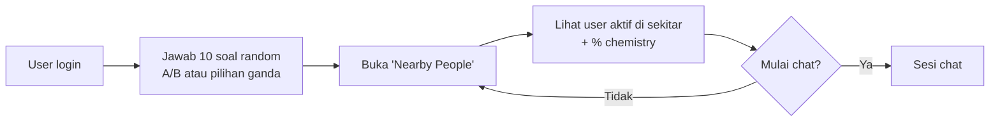
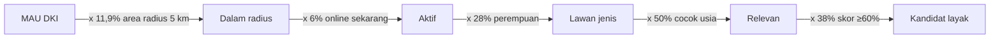
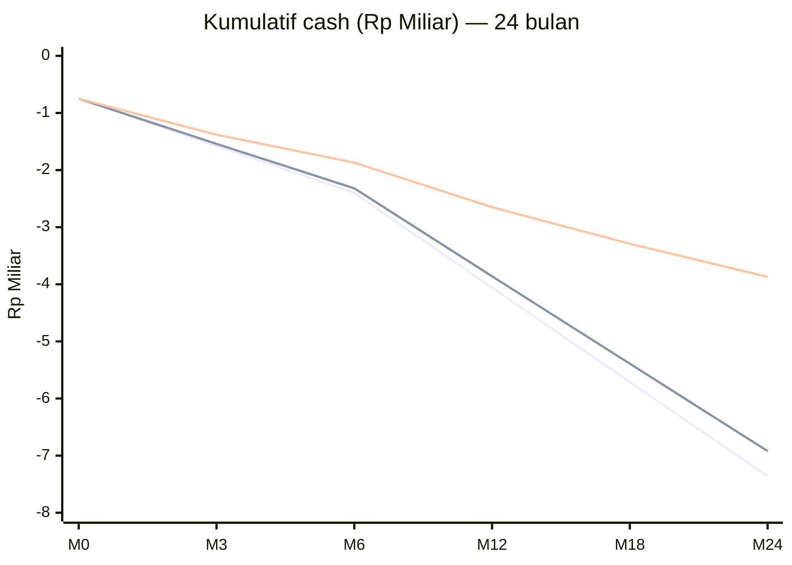

# Evaluasi Kelayakan Bisnis — Dating App "Chemistry Compatibility"

> **Disusun untuk:** Hendri · **Tanggal:** 28 Oktober 2026 · **Pasar acuan:** Indonesia (launch Jabodetabek)
> **Catatan:** Semua angka yang tidak bersumber diberi label **[asumsi]**. Model keuangan & simulasi ada di [`analysis/`](analysis/) dan bisa dijalankan ulang.

---

## 1. Executive Summary

**Verdict: TIDAK LAYAK dikembangkan dalam bentuk sekarang.** Skor kelayakan: **2,9 / 10**.

| # | Alasan utama | Bukti kunci |
|---|---|---|
| 1 | **"Moat" bukan moat.** Fitur bisa ditiru dalam 1–2 sprint dan sudah dimiliki pemain lain | OkCupid (match % sejak ~2004), **Tinder "Chemistry"** (pilot 2025, pilar produk 2026), Hinge "Most Compatible", Boo, Litmatch |
| 2 | **Desain fitur cacat secara matematis.** 10 soal *random* per user → dua user hampir tidak pernah menjawab soal yang sama | Bank 100 soal: rata-rata overlap **1 soal**, 33% pasangan **0 soal sama** |
| 3 | **Skor 10 soal = noise.** Margin error ±31 poin persen | 17% pasangan acak dapat skor ≥70% murni kebetulan |
| 4 | **Masalah sebenarnya: cold start, bukan matching.** "Nearby + aktif sekarang" butuh kepadatan user tinggi | Butuh ~20.000–53.000 MAU di DKI sebelum fitur terasa "hidup" |
| 5 | **Unit economics negatif di semua skenario 24 bulan.** | Base case: LTV/CAC **0,23**, butuh **~281 rb MAU** untuk BEP, burn **Rp 6,9 M** |
| 6 | **Pasar Indonesia kecil & stagnan, kategori global menyusut.** | ~4,5 jt user; casual dating ID ≈ €9 jt (2025), CAGR −0,37%; paying users Bumble −8,7%, Tinder −5% YoY |

**Pakai lensa value investing Anda sendiri:** proyek ini **tidak punya margin of safety**. Downside-nya modal habis Rp 4–7 M, upside-nya tergantung asumsi bull (retensi & konversi 2× di atas rata-rata industri), dan *competitive advantage*-nya bisa dicopy Tinder dalam satu kuartal.

**Rekomendasi:** Jangan build app. Kalau masih tertarik, uji ide **"Chemistry Quiz" sebagai produk viral/event (bukan dating app)** dengan budget ≤ Rp 50 jt selama 8 minggu dan kill criteria tegas (Bagian 11).

---

## 2. Ringkasan Konsep (apa adanya)

| Komponen | Deskripsi |
|---|---|
| Platform | Android + iOS |
| Genre | Dating app, *location-based*, *real-time* (user yang sedang aktif) |
| Diferensiasi yang diklaim | Skor % chemistry dari 10 soal per hari/sesi |
| Model monetisasi | Belum didefinisikan (diasumsikan freemium + langganan, standar industri) |

---

## 3. Uji "Moat": Apakah Ini Benar-Benar Keunggulan Kompetitif?

### 3.1 Tes defensibility (kerangka 7 Powers, Hamilton Helmer)

| Sumber moat | Ada di ide ini? | Penjelasan |
|---|---|---|
| Network effect | ❌ Belum | Justru ini titik lemah: app baru = jaringan kosong |
| Scale economies | ❌ | Tidak ada |
| Switching cost | ❌ | User dating app rata-rata pakai 2–3 app sekaligus (*multi-homing*) |
| Counter-positioning | ⚠️ Lemah | Tinder **sudah** bergerak ke arah yang sama (Chemistry) — tidak ada konflik model bisnis yang mencegah mereka meniru |
| Brand | ❌ | Mulai dari nol; nama "Chemistry" sudah dipakai Tinder |
| Cornered resource | ❌ | Bank soal bukan aset langka |
| Process power | ❌ | Algoritma skor % = matematika SMA, bisa dibuat 1–2 sprint |

**Kesimpulan:** Fitur ≠ moat. Moat di dating app yang sebenarnya adalah **likuiditas lokal** (banyak orang yang relevan di sekitar Anda, sekarang), **brand/trust** (aman, minim scam), dan **rasio gender sehat**. Tidak satupun dibangun oleh fitur kuis.

### 3.2 Fitur ini sudah ada di pasar

| Produk | Mekanisme kompatibilitas | Status |
|---|---|---|
| **OkCupid** (Match Group) | Ratusan *match questions* + jawaban ideal pasangan + bobot kepentingan → match % | Berjalan sejak ~2004; rata-rata user jawab ~230 soal |
| **Tinder Chemistry** | AI + pertanyaan + (opsional) analisis camera roll → 1–2 rekomendasi | Pilot AU/NZ akhir 2025, disebut CEO Match Group sebagai **pilar produk Tinder 2026** |
| **Hinge** | Prompts + "Most Compatible" harian berbasis perilaku | Pertumbuhan paling sehat di portofolio Match |
| **Boo** | MBTI / Enneagram / personality | Pernah top-5 di beberapa negara SEA (2023) |
| **Litmatch** | "Soul Game" (Q&A) + anonymous random chat | Top-3 download dating app Indonesia 2024 |

### 3.3 Apakah skor kompatibilitas memprediksi chemistry? Data bilang **tidak**

- **Eksperimen OkCupid (2014):** pasangan dengan kecocokan asli 30% yang *ditampilkan* 90% punya peluang percakapan **17%**, vs **10%** saat skor asli ditampilkan. Co-founder Christian Rudder: *"The mere myth of compatibility works just as well as the truth."*
- **Kevin Lewis (UC San Diego):** tidak ada bukti match % tinggi menghasilkan hubungan yang berhasil.

**Implikasi:** Skor % berfungsi sebagai **pemicu chat (efek psikologis)**, bukan prediktor. Itu berguna untuk engagement, tapi **tidak bisa dijadikan janji produk** ("kami temukan yang benar-benar cocok") — dan efek plasebo ini juga bisa ditiru siapa saja.

---

## 4. Kritik Desain Produk (cacat logika fitur)

### 4.1 Masalah overlap: soal random membuat skor tidak bisa dihitung

Jika tiap user mendapat 10 soal acak dari bank berisi N soal, jumlah soal yang **sama** antar dua user mengikuti distribusi hipergeometrik:

| Ukuran bank soal (N) | Rata-rata soal sama | P(≥3 soal sama) | P(≥5 soal sama) | P(0 soal sama) |
|---:|---:|---:|---:|---:|
| 30 | 3,3 | 74,9% | 16,9% | 0,6% |
| 50 | 2,0 | 31,4% | 1,8% | 8,3% |
| 100 | 1,0 | 6,0% | 0,07% | **33,0%** |
| 200 | 0,5 | 0,9% | ~0% | **59,1%** |
| 500 | 0,2 | 0,06% | ~0% | **81,6%** |

**Dilema yang tidak bisa diselesaikan:**
- Bank soal **besar** → variasi bagus, tapi skor **tidak bisa dihitung** (hampir tidak ada soal yang sama).
- Bank soal **kecil** → skor bisa dihitung, tapi soal **cepat berulang** dan membosankan dalam 1–2 minggu.
- Alternatif "**semua user dapat 10 soal yang sama per hari**" → user yang login di hari berbeda tidak bisa dibandingkan; skor reset tiap hari.

### 4.2 Masalah noise: 10 soal biner terlalu sedikit

| Jumlah soal | Margin error 95% (jika chemistry sebenarnya 50%) |
|---:|---:|
| **10** | **±31 pp** (skor 50% bisa tampil 19%–81%) |
| 30 | ±18 pp |
| 100 | ±10 pp |
| 230 (OkCupid rata-rata) | ±6,5 pp |

- Dua orang yang **sama sekali tidak berkorelasi** punya peluang **17,2%** mendapat skor ≥70% dan **5,5%** mendapat ≥80%, murni kebetulan.
- Skor akan **berubah setiap hari** untuk pasangan yang sama → user cepat sadar angkanya acak → **kredibilitas fitur inti runtuh**. Ini mirip horoskop: menarik di awal, tidak dipercaya kemudian.

### 4.3 Friksi: 10 soal tiap login menurunkan engagement

| Dampak | Penjelasan |
|---|---|
| Gerbang sebelum value | User ingin langsung lihat orang; dipaksa 10 soal → bounce |
| Jawaban asal | Setelah hari ke-3, user klik cepat tanpa membaca → data makin tidak bermakna |
| Kontradiksi dengan "real-time" | Fitur "user aktif sekarang" butuh login cepat & sering; quiz justru memperlambat |

### 4.4 Cold start / likuiditas: masalah yang paling mematikan

Fitur "nearby + aktif sekarang" hanya bekerja jika ada cukup **lawan jenis, sesuai usia, online pada saat bersamaan, dalam radius dekat**.

**Simulasi:** berapa MAU di DKI Jakarta (661 km²) yang dibutuhkan agar 1 user pria melihat X kandidat aktif dalam radius 5 km pada jam ramai? **[asumsi parameter]**

| Skenario | Online bersamaan | % perempuan | Cocok usia | Filter chemistry ≥60% | MAU untuk 10 kandidat | MAU untuk 20 kandidat |
|---|---:|---:|---:|---:|---:|---:|
| Optimis | 10% | 35% | 60% | – | 4.000 | 8.000 |
| Realistis | 6% | 28% | 50% | – | 10.000 | 20.000 |
| Realistis + filter skor | 6% | 28% | 50% | 38% | **26.400** | **52.700** |

Dalam model keuangan base case (Bagian 7), MAU **total** hanya mencapai ~20.000 setelah 24 bulan. Artinya fitur inti **tidak akan terasa hidup** untuk sebagian besar user, padahal kesan pertama "app kosong" adalah penyebab utama uninstall (69% dating app di-uninstall dalam sebulan).

**Masalah rasio gender:** dating app di Indonesia/Asia umumnya didominasi pria **[asumsi: 70:30]**. Perempuan dibanjiri pesan, pria tidak dapat respons → kedua sisi churn.

### 4.5 Risiko keamanan & penyalahgunaan

| Risiko | Kenapa fitur ini memperparah |
|---|---|
| **Stalking / pelecehan** | "Aktif sekarang + nearby" = sinyal lokasi real-time. Wajib *location fuzzing* & jarak dibulatkan |
| **Scam / love scam / judol / prostitusi online** | App baru dengan moderasi lemah jadi sasaran empuk; bisa memicu blokir Komdigi |
| **Gaming skor** | Bot/scammer menjawab "seperti yang disukai mayoritas" untuk tampil 90%+ |
| **Akun palsu** | Butuh verifikasi selfie/KTP → biaya + data biometrik (UU PDP) |

---

## 5. Analisis Pasar Indonesia

| Indikator | Angka | Sumber |
|---|---|---|
| User online dating Indonesia | ~4,5 juta (2023) | Statista |
| Revenue casual dating Indonesia | ≈ €9,01 jt (2025), CAGR 2025–28 **−0,37%** | Statista Market Outlook |
| Revenue gabungan top-3 (Bumble, Tinder, Tantan) | ≈ US$5,4 jt/tahun | Statista |
| Revenue bulanan Tinder Indonesia | Puncak ≈ US$151 rb (Jan 2023) → ~US$1,8 jt/tahun | Statista |
| Leader download 2024 | Omi, PopUp, Litmatch (Omi ~13,5 jt download) | Statista |
| Pasar dating app global | > US$6 mlr (2024) | Business of Apps |
| CPI Asia Tenggara | ≈ 0,18× CPI AS; Android-heavy, ARPU moderat | Linkrunner |

**Interpretasi:**

1. **Kue revenue kecil.** Tinder — brand dating terbesar di dunia — hanya menghasilkan ~Rp 30 M/tahun di Indonesia **[kurs asumsi Rp 16.500/US$]**. Pemain baru yang merebut 10% pasar top-3 hanya mendapat ~Rp 9 M/tahun revenue kotor.
2. **Download tinggi, monetisasi rendah.** Pemimpin download (Omi, Litmatch) bukan pemimpin revenue → user Indonesia mau install, **enggan bayar**.
3. **Konteks budaya.** Stigma dating app masih kuat di sebagian segmen; segmen serius-menikah (taaruf) lebih mau bayar, tapi butuh positioning berbeda (keluarga, agama, verifikasi ketat).
4. **Kategori global sedang turun.** Bumble paying users −8,7% (Q2 2025), Tinder payers −5% YoY; "dating app fatigue" adalah tren, bukan anomali.

---

## 6. Lanskap Kompetitor vs Ide Ini

| Kriteria | Ide ini | Tinder | Bumble | Hinge | OkCupid | Omi | Litmatch | Boo |
|---|---|---|---|---|---|---|---|---|
| Kompatibilitas berbasis kuis | ✅ (10 soal) | ✅ Chemistry (2026) | ❌ | ⚠️ prompts | ✅✅ (ratusan soal) | ⚠️ | ✅ Soul Game | ✅ MBTI |
| Nearby / real-time | ✅ | ⚠️ | ⚠️ | ❌ | ❌ | ✅ | ✅ | ⚠️ |
| Basis user Indonesia | ❌ 0 | ✅✅ | ✅ | ⚠️ | ⚠️ | ✅✅ | ✅✅ | ✅ |
| Budget marketing | Rendah | Sangat tinggi | Tinggi | Tinggi | Tinggi | Sedang | Sedang | Sedang |
| Trust & safety tim | ❌ | ✅✅ | ✅✅ | ✅✅ | ✅✅ | ✅ | ✅ | ✅ |

**Posisi:** Ide ini masuk sebagai **pemain ke-9+** dengan fitur yang **sudah dimiliki 4 pesaing**, tanpa user, tanpa brand, dan tanpa budget pemasaran sebanding.

---

## 7. Unit Economics & Model Keuangan (24 bulan)

### 7.1 Asumsi **[semua asumsi, dikalibrasi ke benchmark industri]**

| Parameter | Bear | Base | Bull | Catatan |
|---|---:|---:|---:|---|
| Budget marketing / bulan | Rp 150 jt | Rp 150 jt | Rp 150 jt | Fokus Jabodetabek |
| CPI (cost per install) | Rp 25.000 | Rp 18.000 | Rp 12.000 | ≈ US$0,7–1,5 |
| Organik per 1 install berbayar | 0,3 | 0,6 | 1,0 | Bull = viral |
| Install → user aktif | 55% | 60% | 65% | Lolos onboarding |
| Retensi bulan ke-2 | 25% | 35% | 45% | Industri: 69% uninstall < 1 bln |
| Retensi bulanan berikutnya | 70% | 78% | 85% | |
| Konversi ke berbayar (% MAU) | 1,5% | 3% | 5% | Indonesia: WTP rendah |
| ARPPU / bulan | Rp 60 rb | Rp 80 rb | Rp 100 rb | Lebih murah dari Tinder |
| Revenue bersih (setelah fee store, pajak, payment) | 70% | 70% | 70% | Fee store 15–30% |
| Build MVP (bulan 0) | Rp 750 jt | Rp 750 jt | Rp 750 jt | Android+iOS, chat realtime, verifikasi |
| OPEX tim / bulan | Rp 125 jt | Rp 125 jt | Rp 125 jt | Dev, PM, moderasi 24/7, CS, legal |
| Infra / MAU / bulan | Rp 700 | Rp 700 | Rp 700 | Server realtime, OTP, verifikasi selfie, maps |

### 7.2 Hasil

| Metrik | Bear | Base | Bull |
|---|---:|---:|---:|
| MAU bulan ke-6 | 7.300 | 17.100 | 43.400 |
| MAU bulan ke-12 | 7.800 | 19.900 | 56.800 |
| MAU bulan ke-24 | 7.900 | 20.700 | 63.800 |
| Revenue bersih/bulan (M24) | Rp 5 jt | Rp 35 jt | Rp 223 jt |
| Total biaya/bulan (M24) | Rp 281 jt | Rp 289 jt | Rp 320 jt |
| **Net/bulan (M24)** | **−Rp 276 jt** | **−Rp 255 jt** | **−Rp 96 jt** |
| **Kebutuhan modal 24 bulan** | **Rp 7,4 M** | **Rp 6,9 M** | **Rp 3,9 M** |
| Break-even operasional dalam 24 bln | ❌ | ❌ | ❌ |
| LTV per user aktif | Rp 1.155 | Rp 4.353 | Rp 14.000 |
| Blended CAC per user aktif | Rp 34.965 | Rp 18.750 | Rp 9.231 |
| **LTV / CAC** (sehat ≥ 3) | **0,03** | **0,23** | **1,52** |
| Margin kontribusi / MAU / bulan | −Rp 70 | Rp 980 | Rp 2.800 |
| **MAU untuk BEP** | Tidak mungkin | **~281.000** | **~98.000** |

**Membaca hasilnya:**
- **Base case butuh ~281 rb MAU** hanya untuk menutup OPEX + marketing. Itu ≈ **6% dari seluruh user online dating Indonesia**, dan revenue-nya ≈ Rp 470 jt/bulan ≈ **19% revenue Tinder Indonesia** — dari app baru tanpa moat. Tidak realistis.
- **Bull case** pun belum BEP dalam 24 bulan, dan asumsinya (retensi 45%→85%, konversi 5%) **di atas rata-rata industri global**, apalagi Indonesia.
- Masalah utamanya **bukan biaya**, tapi **revenue per user yang sangat kecil** dibanding biaya akuisisi + churn yang tinggi.

*(Garis atas ke bawah pada M24: Bull, Base, Bear.)*

---

## 8. Regulasi & Risk Register

### 8.1 Kewajiban regulasi Indonesia

| Regulasi | Kewajiban | Konsekuensi jika lalai |
|---|---|---|
| **PSE Lingkup Privat** (Permenkominfo 5/2020) | Wajib daftar sebelum beroperasi | Diblokir — contoh: Zangi diblokir Okt 2025; Komdigi minta Apple/Google delist **Hornet** (dating app) |
| **UU PDP No. 27/2022** | Dasar hukum pemrosesan, DPO, DPIA untuk pemrosesan berisiko tinggi (lokasi real-time, biometrik selfie = data pribadi spesifik), notifikasi kebocoran 3×24 jam | Denda administratif hingga 2% pendapatan tahunan + pidana |
| **UU ITE & UU Pornografi** | Moderasi konten asusila, prostitusi online, judol | Takedown, blokir, pidana |
| **PP 17/2025 (PP Tunas) & perlindungan anak** | Verifikasi usia, larangan user di bawah umur | Sanksi administratif hingga blokir |
| **Kebijakan App Store / Google Play** | 18+, fitur report/block, moderasi UGC, hapus akun | App ditolak/di-takedown |
| **Norma sosial** | Komdigi menegaskan platform harus sesuai "nilai & norma" Indonesia | Tekanan publik → delisting |

### 8.2 Risk register

| Risiko | Probabilitas | Dampak | Skor | Mitigasi |
|---|:-:|:-:|:-:|---|
| Cold start — app terasa kosong | Tinggi | Sangat tinggi | 🔴 | Launch hyper-lokal (1 kampus/1 komunitas), event offline |
| Fitur ditiru incumbent | Tinggi | Tinggi | 🔴 | Tidak ada mitigasi efektif — fitur ≠ moat |
| Skor dianggap acak → hilang kredibilitas | Tinggi | Tinggi | 🔴 | Bank soal tetap & akumulatif (lihat pivot) |
| Rasio gender timpang | Tinggi | Tinggi | 🔴 | Akuisisi perempuan dulu, women-first features |
| Scam, prostitusi online, judol | Sedang | Sangat tinggi | 🔴 | Verifikasi selfie, moderasi 24/7, AI filter |
| Kebocoran data lokasi/biometrik | Sedang | Sangat tinggi | 🟠 | Location fuzzing, enkripsi, DPIA |
| Blokir/delisting regulator | Rendah–sedang | Sangat tinggi | 🟠 | Daftar PSE sejak awal, positioning "serius" |
| Konflik merek "Chemistry" | Sedang | Sedang | 🟠 | Jangan pakai nama tersebut |
| Kehabisan modal sebelum PMF | Tinggi | Sangat tinggi | 🔴 | Validasi ≤ Rp 50 jt sebelum build |

---

## 9. SWOT

| **Strengths** | **Weaknesses** |
|---|---|
| Mekanik kuis menyenangkan & mudah dipahami | Fitur mudah ditiru; tidak ada moat struktural |
| Skor % terbukti meningkatkan inisiasi chat (efek OkCupid) | Skor dari 10 soal random = noise (±31 pp), overlap soal hampir nol |
| Kuis harian bisa jadi kebiasaan (*daily ritual*) | Friksi 10 soal tiap login; cold start parah untuk fitur nearby-real-time |
| | Founder tanpa tim/jaringan consumer-tech & tanpa user base awal |

| **Opportunities** | **Threats** |
|---|---|
| Kuis kepribadian sangat *shareable* di TikTok/IG (konten viral) | Tinder Chemistry diluncurkan luas 2026 dengan basis user jutaan |
| Segmen serius-menikah / komunitas niche (WTP lebih tinggi) | Dating app fatigue global; paying users turun |
| Format offline/event (dinner, speed dating) yang memakai kuis | Regulasi PSE, UU PDP, norma sosial; risiko blokir |
| B2B: fitur kuis untuk komunitas/event organizer | Love scam & penyalahgunaan merusak brand |

---

## 10. Opsi Pivot yang Lebih Masuk Akal

| Opsi | Deskripsi | Kenapa lebih baik | Risiko |
|---|---|---|---|
| **A. "Chemistry Game" sinkron di dalam chat** | Setelah match, **kedua user menjawab 10 soal yang sama secara real-time**, skor muncul di akhir sebagai icebreaker | Menyelesaikan masalah overlap; jadi alat percakapan, bukan klaim prediksi | Tetap butuh dating app sebagai wadah (cold start tetap ada) |
| **B. "Soal Hari Ini" ala Wordle** | 1 set soal **sama untuk semua orang tiap hari**, hasil bisa di-share ("aku & kamu 80% cocok") | Viral loop gratis, bisa diluncurkan sebagai web tanpa app | Monetisasi lemah; lebih cocok sebagai alat akuisisi |
| **C. Bank soal tetap & akumulatif** | Profil kompatibilitas dibangun bertahap (mis. 5 soal/hari dari bank tetap, total 100+ soal); skor makin akurat | Skor stabil & kredibel; jadi aset data jangka panjang | Persis model OkCupid → masih bukan moat |
| **D. Offline-first / event** | Kuis → dicocokkan ke dinner/aktivitas grup 6 orang di Jakarta (model sejenis Timeleft) | Tidak butuh kepadatan user real-time; monetisasi per tiket; aman & lebih diterima secara sosial | Operasional berat; skala per kota |
| **E. Niche vertikal** | Mis. profesional muda Muslim serius menikah / komunitas hobi | WTP lebih tinggi, komunitas = distribusi | Pasar lebih kecil, kompetitor niche sudah ada |

**Kombinasi paling masuk akal:** **B (akuisisi viral) → D (monetisasi via event)**. Ini menguji apakah "chemistry quiz" punya daya tarik nyata **tanpa** membakar Rp 750 jt untuk app.

---

## 11. Rencana Validasi Murah (sebelum menulis 1 baris kode app)

**Budget maksimal: Rp 50 jt · Durasi: 8 minggu · Lokasi: Jakarta**

| Minggu | Aktivitas | Biaya [asumsi] |
|---|---|---:|
| 1–2 | Landing page + web quiz "Soal Hari Ini" (no-code: Typeform/Tally + Carrd) dengan fitur share hasil ke pasangan/teman | Rp 3 jt |
| 2–5 | Iklan TikTok/IG + 5–10 micro-influencer Jakarta | Rp 25 jt |
| 5–8 | 2 event offline (dinner/speed dating 30–40 orang) memakai hasil kuis untuk mengelompokkan peserta, tiket berbayar | Rp 15 jt (sebagian tertutup tiket) |
| 8 | Evaluasi go / no-go | – |

### Kill criteria (angka tegas)

| KPI | Lanjut jika | Stop jika |
|---|---:|---:|
| Completion rate kuis | ≥ 60% | < 40% |
| Share rate (hasil dibagikan) | ≥ 15% | < 5% |
| Waitlist di Jakarta | ≥ 2.000 | < 500 |
| Rasio perempuan di waitlist | ≥ 40% | < 25% |
| Kembali main ≥3 hari dalam 7 hari (D7 retention) | ≥ 25% | < 10% |
| Tiket event terjual (harga ≥ Rp 150 rb) | ≥ 70% kursi | < 30% kursi |
| Peserta event bilang "chemistry score akurat/berguna" | ≥ 50% | < 25% |

Lolos **semua** → baru pertimbangkan build MVP (dan tetap mulai dari web/PWA, bukan native app). Gagal ≥2 KPI → **stop**, kerugian maksimal Rp 50 jt.

---

## 12. Verdict Akhir & Scorecard

| Kriteria | Bobot | Skor (1–10) | Tertimbang | Catatan |
|---|---:|---:|---:|---|
| Diferensiasi / moat | 25% | 2 | 0,50 | Sudah ada di OkCupid, Tinder, Hinge, Boo, Litmatch |
| Kelayakan desain produk | 15% | 3 | 0,45 | Overlap soal & noise skor; perlu redesign total |
| Ukuran & tren pasar | 15% | 4 | 0,60 | Kecil, stagnan, WTP rendah |
| Unit economics | 20% | 2 | 0,40 | LTV/CAC 0,23 (base), BEP butuh 281 rb MAU |
| Kemudahan eksekusi (cold start, tim) | 15% | 3 | 0,45 | Likuiditas real-time sangat sulit |
| Risiko regulasi & keamanan | 10% | 5 | 0,50 | Bisa dikelola, tapi biaya tinggi |
| **Total** | **100%** | | **2,90 / 10** | **TIDAK LAYAK** |

### Keputusan

| Pertanyaan | Jawaban |
|---|---|
| Build app dating sesuai konsep sekarang? | **❌ Tidak.** Burn Rp 4–7 M, peluang BEP sangat kecil |
| Apakah "chemistry %" adalah moat? | **❌ Tidak.** Fitur, bukan keunggulan kompetitif; incumbent sudah punya |
| Ada nilai yang bisa diselamatkan? | **⚠️ Ya, sedikit:** kuis sebagai **alat viral + icebreaker + event offline** |
| Langkah berikut yang disarankan | Validasi 8 minggu, ≤ Rp 50 jt, dengan kill criteria di Bagian 11 |
| Alternatif penggunaan modal Rp 5–7 M | Dengan profil Anda (value investor, MOS ~30%), modal ini punya *expected return* jauh lebih baik di portofolio IDX atau ekspansi Apotek Alpro, yang Anda punya keunggulan operasionalnya |

---

## 13. Sumber

**Pasar & industri**
- Statista — [Online dating in Indonesia](https://www.statista.com/topics/10591/online-dating-in-indonesia), [Casual Dating – Indonesia](https://es.statista.com/outlook/dmo/eservices/dating-services/casual-dating/indonesia), [Leading dating apps by downloads](https://statista.com/statistics/1366529/indonesia-leading-dating-applications-by-downloads), [Tinder monthly revenue Indonesia](https://es.statista.com/statistics/1366543/indonesia-tinder-monthly-revenue/), [Omi monthly downloads](https://www.statista.com/statistics/1366741/indonesia-omi-app-monthly-downloads)
- [Business of Apps — Dating App Report 2025](https://www.businessofapps.com/data/dating-app-report/)
- [Nasdaq — Bumble app revenues decline / user churn](https://www.nasdaq.com/articles/bumble-app-revenues-decline-user-churn-bigger-threat-growth)
- [Barchart — Bumble's paying users drop 8.7% in Q2](https://www.barchart.com/story/news/34052669/bumble-s-paying-users-drop-8-7-in-q2-buy-sell-or-hold-the-stock)
- [Global Dating Insights — 69% of dating apps uninstalled within a month](https://www.globaldatinginsights.com/featured/69-of-dating-apps-are-uninstalled-within-a-month/)
- [Linkrunner — Cost per install benchmark](https://linkrunner.io/cost-per-install-benchmark)
- [Liftoff — 2022 Dating Apps Report](https://content.liftoff.io/hubfs/aaa_Reports/2022/2022%20Dating%20Apps%20Report%20-%20EN.pdf)

**Kompetitor & fitur kompatibilitas**
- [TechCrunch — Tinder Chemistry](https://techcrunch.com/?p=3089496)
- [Global Dating Insights — Tinder tests camera roll AI matching](https://www.globaldatinginsights.com/featured/tinder-tests-camera-roll-ai-analysis-matching-feature/)
- [ContentGrip — Tinder leans into AI](https://www.contentgrip.com/tinder-ai-chemistry-matching/)
- [Hinge — 2025 product evolution](https://hinge.co/newsroom/hinge-2025-product-evolution)
- [Marie Claire — How Hinge decides "Most Compatible"](https://www.marieclaire.co.uk/life/sex-and-relationships/dating-app-hinge-most-compatible-696147)
- [Global Dating Insights — Boo, the personality-driven dating app](https://www.globaldatinginsights.com/news/boo-the-personality-driven-dating-app/)
- [JSTOR Daily — Don't fall in love on OkCupid](https://daily.jstor.org/dont-fall-in-love-okcupid/)
- [The Society Pages — Does homogamy matter?](https://thesocietypages.org/socimages/2014/09/10/does-homogamy-matter/)
- [ITPro — OkCupid admits to experiments on users](https://itpro.com/strategy/22792/okcupid-admits-to-experiments-on-users)

**Regulasi Indonesia**
- [Antara — RI asks Apple, Google to remove Hornet app](https://en.antaranews.com/news/427240/ri-asks-apple-google-remove-hornet-app)
- [Selular.id — Zangi diblokir Komdigi karena tak daftar PSE](https://selular.id/2025/10/aplikasi-zangi-diblokir-komdigi-gara-gara-tak-daftar-pse/)
- [Selular.id — Komdigi catat ratusan aduan potensi pelanggaran data pribadi](https://selular.id/2026/01/komdigi-catat-ratusan-aduan-dan-potensi-pelanggaran-data-pribadi/)
- [Marketing-Interactive — Komdigi warns 25 unregistered platforms](https://www.marketing-interactive.com/komdigi-raises-stakes-on-digital-compliance-warns-25-unregistered-platforms)

---
*Simulasi overlap soal, noise skor, likuiditas, dan model keuangan: [`analysis/compatibility_math.py`](analysis/compatibility_math.py) dan [`analysis/financial_model.py`](analysis/financial_model.py).*
